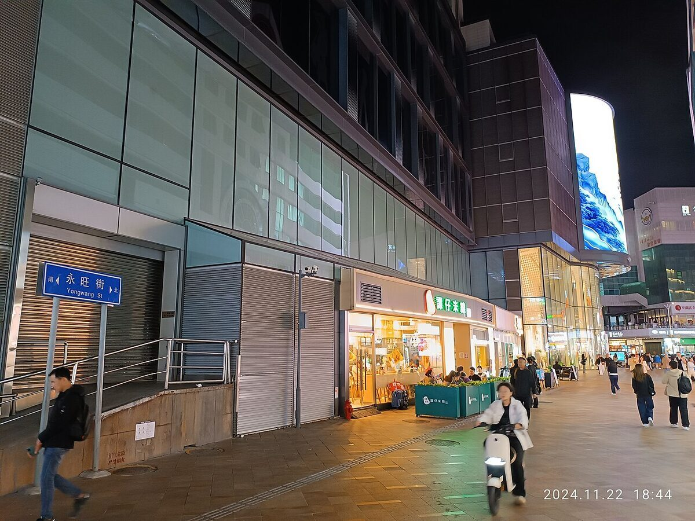
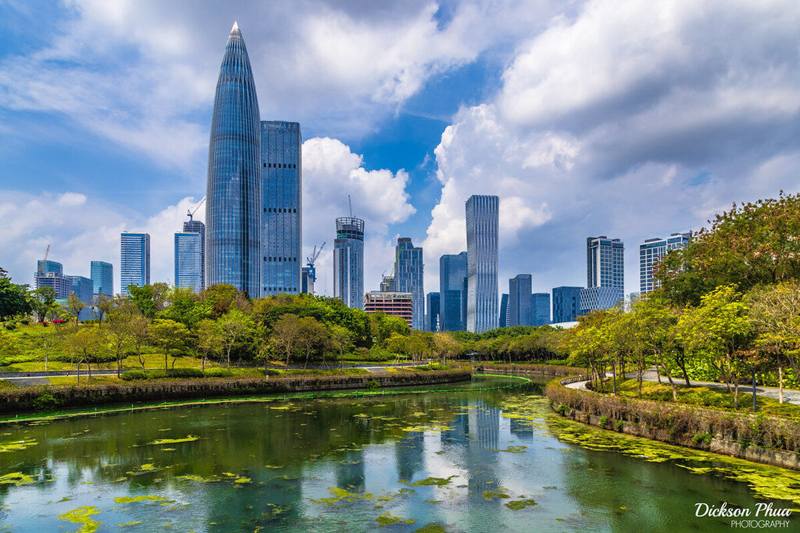
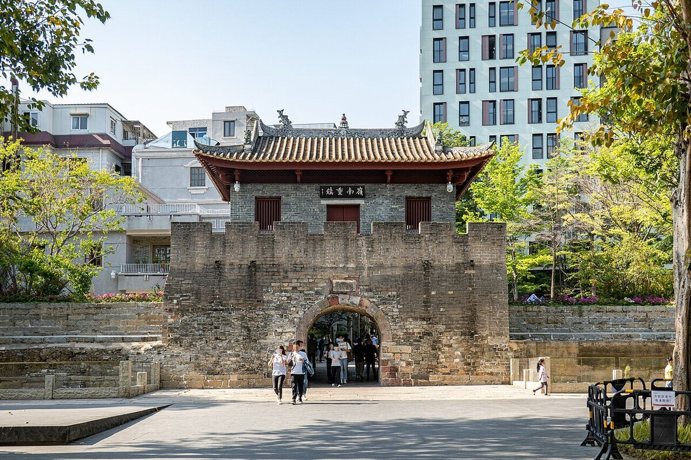

# Shenzhen trip plan

**Hotel:** 加来酒店 (Calais Hotel) — 深圳福田口岸店  
**Address:** 福田区福民路皇岗公园街8号 (皇岗公园东大门)  
**Phone:** [+86-755-88257999](tel:+8675588257999) · Booking [removed]

**Nearest metro:** 皇岗村 (Huanggangcun), Line 7, Exit A — 430 m / 7 min walk  
**Also close:** Futian Checkpoint (福田口岸), Lines 4 & 10 — ~1.1 km / 15 min walk

14 places, sorted closest → furthest. Photos are freely licensed (credits at the bottom).

---

## 1. The short version

- **Arrive:** high-speed rail from West Kowloon to **福田 (Futian)** — 14 min, ¥68 — then a 3 km DiDi.
- **Best of the list:** Ping An Free Sky at sunset · Talent Park at sunset · Happy Harbour wheel · DMD Food City · Upper Hills + 莲花山公园.
- **Skip unless passing:** 文化馆, 保利文化广场, 东门町广场.
- **Money:** Alipay or WeChat Pay with a foreign card; metro gates also take contactless Visa/Mastercard.
- **Bring:** passport everywhere — trains, hotel, museums.

---

## 2. Getting from Tung Chung to the hotel

| Option | Route | Time | Cost | Verdict |
|---|---|---|---|---|
| **A. High-speed rail** | Tung Chung → Kowloon → walk to West Kowloon → HSR to 福田 → DiDi | 1 h 50 – 2 h 15 | ≈ HK$19 + ¥68 + ¥15 ≈ **HK$110** | Fastest, one immigration, easiest with bags |
| **B. East Rail** | Tung Chung → Nam Cheong (南昌) → Hung Hom (红磡) → East Rail → Lok Ma Chau (落马洲) → Futian Port (福田口岸) → ~1.1 km walk | 2 h 10 – 2 h 40 | **HK$57.5** | Cheapest; the port is next to the hotel |
| **C. Coach** | S1 bus to HKIA → cross-border coach → 福田/皇岗 | 2 h 30 + | ~HK$120–180 | Only if you're already at the airport |

### A — High-speed rail, step by step (recommended)

| Step | What | Time | Cost |
|---|---|---|---|
| 1 | 东涌 (Tung Chung) → 九龙 (Kowloon), Tung Chung Line | 28 min | HK$18.7 |
| 2 | Walk Kowloon → 西九龙 (West Kowloon) through Elements | 10 min | — |
| 3 | HK exit + mainland entry + security **at West Kowloon** | 30–45 min | — |
| 4 | 西九龙 → 福田, G-train | 14–18 min | ¥68 (2nd class) |
| 5 | 福田站 → hotel, DiDi | 10–15 min | ¥15–20 |

**Faster first leg:** Tung Chung → 南昌 (Nam Cheong, 10 min) → Tuen Ma Line one stop to 柯士甸 (Austin, 5 min) → 5 min covered walk to West Kowloon. Saves ~10 min over the Kowloon walk.

**Booking the train.** Use the **12306** app (English UI) or Trip.com, or buy at the West Kowloon counters. You need your **passport number**; the ticket is tied to it. ~40 trains a day to 福田, roughly **07:00–23:00**, every 5–20 min. Book a day ahead on weekends and holidays.

**What to expect at West Kowloon.** It's a co-located border: you clear Hong Kong exit and mainland entry *before* boarding, then walk straight out at 福田 with no further checks. Arrive **45 min before departure** (60 min at peak). Security is airport-style — liquids are fine, but no lighters and no power banks over 100 Wh. There are currency exchanges and SIM counters airside.

**At 福田站.** You arrive underground beneath 益田路. Follow signs to 地铁 (Metro): Lines 2, 3 and 11. For a DiDi, use the designated pickup level — the station is huge, so match the car's PIN and meet at the signed pick-up zone rather than the taxi rank.

### The HSR journey, minute by minute

| When | What happens |
|---|---|
| Before | Book on **12306** (English UI) or Trip.com with your passport number. There is no paper ticket — your passport *is* the ticket. |
| T-45 | Enter West Kowloon at B1. **Security first**: bag scan, no lighters, power banks must be under 100 Wh and in your hand luggage. |
| T-35 | **Hong Kong immigration** (e-channel or counter). |
| T-25 | **Mainland immigration** — this queue is the variable; it's where the 30–45 min goes. |
| T-10 | Walk to your gate (numbered 1–15). **Gates close 5 min before departure.** |
| T-0 | 14–18 min to 福田. The stop is short — stand up early. |
| Arrive | You're already inside China; walk straight out. Follow **地铁 (Metro)** for Lines 2/3/11 or **网约车** for the DiDi pickup level. |

**Luggage:** overhead racks plus racks at carriage ends; no weight check on this route. **Seats:** second class is 3+2 and fine for 15 min; first class (¥109) is 2+2 if you want quiet.

### B — East Rail via 落马洲 / 福田口岸 (cheapest)

1. Tung Chung (东涌) → Nam Cheong (南昌) (Tung Chung Line, 10 min) → Hung Hom (红磡) (Tuen Ma Line, ~12 min) → Lok Ma Chau (落马洲) (East Rail, ~40 min). Total ~75–85 min, **HK$57.5** on Octopus.
2. Cross at **福田口岸 (Futian Port)**: open **06:30–22:30**, 15–30 min. Two checks, one walkway.
3. The hotel is **~1.1 km** from the port — 15 min on foot, or ¥10 by DiDi.

East Rail last trains to Lok Ma Chau (落马洲) leave Hung Hom (红磡) around 21:35 and Admiralty (金钟) around 21:29 — **don't use this route if you land late**. For late arrivals use the HSR (runs to ~23:00) or 皇岗口岸 (Huanggang Port, 24 h, 1.4 km from the hotel).

### C — Coach from the airport

S1 bus from Tung Chung (东涌) → HKIA (~10 min, HK$3.5), then a cross-border coach to Futian (福田) or Huanggang (皇岗) (~HK$120–180, 60–90 min plus the border). Slower than the train and you still queue — only worth it if you're already at HKIA with a lot of luggage.

---

## 3. Trains and metro — the details

**Shenzhen Metro, in practice**
- 17 lines, 400+ stations, announcements in Mandarin/Cantonese/English, signage in English.
- **Pay:** tap a contactless **Visa / Mastercard / Amex / JCB** on the gate (works across the network since 2026), or use **Alipay → Transport → 深圳地铁** QR. Use the *same* method in and out — mixing them creates an incomplete trip and a red gate.
- **Fares:** ¥2–8. Gates close ~23:00–23:30 depending on the line.
- **Exits matter:** station exits can be 500 m apart. Check the exit letter in this guide before you go up.
- **Rush hour:** 08:00–09:30 and 17:30–19:30. Avoid Line 4 and Line 1 with luggage.

**DiDi, in practice**
- The DiDi app has an English mode and takes foreign cards. Set your pickup pin carefully — drivers call to confirm; the in-app chat auto-translates.
- Typical fares from the hotel are listed on each place below (DiDi Express, no surge).
- At stations and malls use the signed **网约车 (ride-hailing) pickup point**, not the taxi rank.

**About direct DiDi links:** DiDi has no public link format that pre-fills an origin and destination. The supported way is DiDi's own API (the DiDi MCP, `taxi_generate_ride_app_link`, free key at mcp.didichuxing.com), which returns a `v.didi.cn` link that opens the app with both ends filled in. If you want those 14 links generated, get a key and I'll wire them in. Until then, each place below gives you a **copy-paste Chinese block** for the DiDi destination field, plus an Amap route link.

---

## 4. Places, closest → furthest

`km` straight line from the hotel · `DiDi` road distance/time · `Metro` door-to-door · `Fun` 1–10

| # | Place | 中文 | Area | km | DiDi | Metro | Fun |
|---|---|---|---|---|---|---|---|
| 1 | Ping'an International Financial Center | 平安金融中心 | Futian | 1.36 | 8 min / 3.0 km | L4 Futian Checkpoint → Convention & Exhibition Center → L1 Shopping Park (3 stops) · 16 min | **8** |
| 2 | Museum of Contemporary Art & Planning Exhibition | 深圳当代艺术与城市规划馆 | Futian | 2.59 | 12 min / 3.5 km | L4 Futian Checkpoint → Civic Center (3 stops) + 340 m walk · 18 min | **7** |
| 3 | Upper Hills (深业上城) | 深业上城 | Futian | 4.03 | 14 min / 5.6 km | L10 Futian Checkpoint → Donggualing (5 stops, direct) · 25 min | **7** |
| 4 | Shenzhen Cultural Center (Jingtian) | 深圳市文化馆 | Futian | 4.11 | 16 min / 6.4 km | L4 Futian Checkpoint → Civic Center → L2 Jingtian (3 + 3 stops) · 28 min | **3** |
| 5 | Shenzhen Grand Theatre | 深圳大剧院 | Luohu | 5.24 | 19 min / 7.2 km | L4 Futian Checkpoint → Civic Center → L2 Grand Theater (3 + 4 stops) · 28 min | **4** |
| 6 | The Mixc of Shenzhen City Crossing | 深圳万象城 | Luohu | 5.62 | 21 min / 8.1 km | L4 Futian Checkpoint → Civic Center → L2 Grand Theater (3 + 4 stops) · 28 min | **5** |
| 7 | Dong Men Ding Plaza | 东门町广场 | Luohu | 6.55 | 25 min / 9.5 km | As DMD Food City, then 230 m walk · 31 min | **3** |
| 8 | DMD Food City (东门町美食城) | 东门町美食城 | Luohu | 6.59 | 25 min / 9.4 km | L4 Futian Checkpoint → Convention & Exhibition Center → L1 Laojie (2 + 5 stops) · 30 min | **7** |
| 9 | Dongmen Pedestrian Street | 东门步行街 | Luohu | 6.77 | 25 min / 9.7 km | L4 Futian Checkpoint → Civic Center → L2 Hubei (3 + 5 stops) · 32 min | **6** |
| 10 | MixC World 万象天地 (Nanshan) | 万象天地 | Nanshan | 10.95 | 23 min / 16.6 km | L7 Huanggangcun → Chegongmiao → L1 Hi-Tech Park (4 + 6 stops) · 40 min | **7** |
| 11 | Shenzhen Talent Park | 深圳人才公园 | Nanshan | 11.74 | 25 min / 16.5 km | L7 Huanggangcun → Chegongmiao → L11 Houhai → L13 Talent Park · 45 min | **8** |
| 12 | Shenzhen Poly Cultural Plaza | 深圳保利文化广场 | Nanshan | 12.45 | 23 min / 16.3 km | L7 Huanggangcun → Chegongmiao → L11 Houhai (4 + 2 stops) · 40 min | **3** |
| 13 | Nantou Ancient City | 南头古城 | Nanshan | 14.49 | 24 min / 21.7 km | L7 Huanggangcun → Chegongmiao → L1 Taoyuan → L12 Nantou Ancient City (2 changes) · 55 min | **5** |
| 14 | Happy Harbour | 欢乐港湾 | Bao'an | 18.2 | 31 min / 25.4 km | L7 Huanggangcun → Chegongmiao → L11 Qianhai Bay → L5 Linhai · 50 min | **8** |

### Ping'an International Financial Center — 平安金融中心


*Ping An International Finance Centre (平安金融中心), Futian CBD*
**Fun 8/10** · Futian · Observation deck · **1.36 km** from the hotel

- **Getting there:** L4 Futian Checkpoint → Convention & Exhibition Center → L1 Shopping Park (3 stops) (~16 min) or DiDi 8 min / 3.0 km.
- **Sweet spot:** 116F, the west/southwest corner windows about 30 min before sunset — you look straight down 益田路 and across to 莲花山公园. Do daylight → sunset → lights on one ¥180 ticket.
- **What to expect:** Airport-style security (bag scan), a 55-second lift, then an open 360° deck. 45–60 min inside. Buy online (¥180) instead of ¥200 at the counter.
- **Look out for:** Last entry 19:15, 20:15 on Fri/Sat. Haze after a humid day ruins the view — check the visibility before paying. No tripods. **Fanny's note:** the tower's base is just a commercial block next to COCO Park — the observation deck is the only reason to go; skip the building itself.
- **Links:** [Amap pin](https://uri.amap.com/marker?position=114.055865,22.533096&name=Ping%27an%20International%20Financial%20Center&src=trip&coordinate=gaode&callnative=0) · [Amap route from hotel](https://uri.amap.com/navigation?from=114.05994,22.52147,Hotel&to=114.055865,22.533096,Ping%27an%20International%20Financial%20Center&mode=bus&coordinate=gaode&callnative=0) · [Google Maps](https://www.google.com/maps/place/Ping'an+International+Financial+Center/@22.5331818,113.9200248,12z/data=!4m10!1m3!11m2!2sit_Z1UV5ArUkUOq6M16oRQ!3e3!3m5!1s0x3403f403f3fd7827:0xad499e4e2a20c5db!8m2!3d22.533096!4d114.055865!16s%2Fm%2F09k5qh4?entry=ttu&g_ep=EgoyMDI2MTExOC4xIKXMDSoASAFQAw%3D%3D)
- **DiDi destination (copy this):**
  ```
  平安金融中心
  ```

### Museum of Contemporary Art & Planning Exhibition — 深圳当代艺术与城市规划馆


*Museum of Contemporary Art & Planning Exhibition (当代艺术与城市规划馆)*
**Fun 7/10** · Futian · Museum · **2.59 km** from the hotel

- **Getting there:** L4 Futian Checkpoint → Civic Center (3 stops) + 340 m walk (~18 min) or DiDi 12 min / 3.5 km.
- **Sweet spot:** The ground-floor atrium and the giant city-model hall (north wing, floors 3–5). The brushed-aluminium skin looks best in mid-afternoon light.
- **What to expect:** Free, no booking, Tue–Sun 10:00–18:00. Security x-ray at the door, 1–1.5 h inside. English captions are patchy; the model is the highlight.
- **Look out for:** Closed Mondays. Some touring exhibitions charge separately. No food or drink inside; free lockers at the entrance.
- **Links:** [Amap pin](https://uri.amap.com/marker?position=114.061277,22.544771&name=Museum%20of%20Contemporary%20Art%20%26%20Planning%20Exhibition&src=trip&coordinate=gaode&callnative=0) · [Amap route from hotel](https://uri.amap.com/navigation?from=114.05994,22.52147,Hotel&to=114.061277,22.544771,Museum%20of%20Contemporary%20Art%20%26%20Planning%20Exhibition&mode=bus&coordinate=gaode&callnative=0) · [Google Maps](https://www.google.com/maps/place/Museum+of+Contemporary+Art+%26+Planning+Exhibition/@22.544771,112.841795,9z/data=!4m10!1m3!11m2!2sit_Z1UV5ArUkUOq6M16oRQ!3e3!3m5!1s0x3403f5fedadbc56d:0x237bf856bb4e0137!8m2!3d22.544771!4d114.0612774!16s%2Fg%2F11h283g971?entry=ttu&g_ep=EgoyMDI2MTExOC4xIKXMDSoASAFQAw%3D%3D)
- **DiDi destination (copy this):**
  ```
  深圳当代艺术与城市规划馆
  ```

### Upper Hills (深业上城)


*MUJI Diner at Upper Hills (深业上城)*

*莲花山公园 (Lianhuashan Park) — the park at the end of the bridge*

**Fun 7/10** · Futian · Lifestyle mall + park bridge · **4.03 km** from the hotel

- **Getting there:** L10 Futian Checkpoint → Donggualing (5 stops, direct) (~25 min) or DiDi 14 min / 5.6 km.
- **Sweet spot:** The loft lanes and coffee terraces, then the footbridge into 莲花山公园 — a 15–20 min climb to the Deng Xiaoping statue for the classic CBD skyline at sunset, free.
- **What to expect:** An open-air mall (MUJI Hotel/Diner, duty-free, design shops) plus a big park. 2–3 h if you do both. This is the best free sunset in the city.
- **Look out for:** The bridge and park climb are unshaded — go after 16:00. Few toilets near the summit. The mall is quiet on weekday mornings.
- **Links:** [Amap pin](https://uri.amap.com/marker?position=114.070537,22.556332&name=Upper%20Hills%20%28%E6%B7%B1%E4%B8%9A%E4%B8%8A%E5%9F%8E%29&src=trip&coordinate=gaode&callnative=0) · [Amap route from hotel](https://uri.amap.com/navigation?from=114.05994,22.52147,Hotel&to=114.070537,22.556332,Upper%20Hills%20%28%E6%B7%B1%E4%B8%9A%E4%B8%8A%E5%9F%8E%29&mode=bus&coordinate=gaode&callnative=0) · [Google Maps](https://www.google.com/maps/place/%E6%B7%B1%E4%B8%9A%E4%B8%8A%E5%9F%8E/@22.5563318,114.070537,17z/data=!4m7!3m6!1s0x3403f5d813dfb6b9:0x7a85f14e08f5bce0!8m2!3d22.5563318!4d114.070537!16s%2Fg%2F11fhz0ljjc)
- **DiDi destination (copy this):**
  ```
  深业上城
  ```

### Shenzhen Cultural Center (Jingtian) — 深圳市文化馆

**Fun 3/10** · Futian · Arts venue · **4.11 km** from the hotel

- **Getting there:** L4 Futian Checkpoint → Civic Center → L2 Jingtian (3 + 3 stops) (~28 min) or DiDi 16 min / 6.4 km.
- **Sweet spot:** Whatever is on that week — it's a working arts centre, not a sight.
- **What to expect:** A neighbourhood venue in 景田; small exhibitions and performances.
- **Look out for:** Check the programme first; parts close on Mondays. Easy to skip on a 3-day trip.
- **Links:** [Amap pin](https://uri.amap.com/marker?position=114.043557,22.55523&name=Shenzhen%20Cultural%20Center%20%28Jingtian%29&src=trip&coordinate=gaode&callnative=0) · [Amap route from hotel](https://uri.amap.com/navigation?from=114.05994,22.52147,Hotel&to=114.043557,22.55523,Shenzhen%20Cultural%20Center%20%28Jingtian%29&mode=bus&coordinate=gaode&callnative=0) · [Google Maps](https://www.google.com/maps/place/Shenzhen+Cultural+Center/@22.55523,112.8240746,9z/data=!4m10!1m3!11m2!2sit_Z1UV5ArUkUOq6M16oRQ!3e3!3m5!1s0x3403f38b835cc389:0xd796ef4f35c4b1cc!8m2!3d22.55523!4d114.043557!16s%2Fm%2F04ldglg?entry=ttu&g_ep=EgoyMDI2MTExOC4xIKXMDSoASAFQAw%3D%3D)
- **DiDi destination (copy this):**
  ```
  深圳市文化馆
  ```

### Shenzhen Grand Theatre — 深圳大剧院


*Shenzhen Grand Theatre (深圳大剧院)*
**Fun 4/10** · Luohu · Performing arts · **5.24 km** from the hotel

- **Getting there:** L4 Futian Checkpoint → Civic Center → L2 Grand Theater (3 + 4 stops) (~28 min) or DiDi 19 min / 7.2 km.
- **Sweet spot:** The glass lobby lit up before a performance.
- **What to expect:** A ticketed concert/ theatre house; without a ticket it's a 5-minute look.
- **Look out for:** Don't build a day around it unless you've booked a show — check 大麦/Damai for that week.
- **Links:** [Amap pin](https://uri.amap.com/marker?position=114.10546,22.542692&name=Shenzhen%20Grand%20Theatre&src=trip&coordinate=gaode&callnative=0) · [Amap route from hotel](https://uri.amap.com/navigation?from=114.05994,22.52147,Hotel&to=114.10546,22.542692,Shenzhen%20Grand%20Theatre&mode=bus&coordinate=gaode&callnative=0) · [Google Maps](https://www.google.com/maps/place/Shenzhen+Grand+Theatre/@22.542692,112.8859776,9z/data=!4m10!1m3!11m2!2sit_Z1UV5ArUkUOq6M16oRQ!3e3!3m5!1s0x3403f5b7d46a8e0b:0x9656bf8761859c01!8m2!3d22.542692!4d114.10546!16s%2Fg%2F11x1nm6_8?entry=ttu&g_ep=EgoyMDI2MTExOC4xIKXMDSoASAFQAw%3D%3D)
- **DiDi destination (copy this):**
  ```
  深圳大剧院
  ```

### The Mixc of Shenzhen City Crossing — 深圳万象城


*The MixC (深圳万象城), Luohu*
**Fun 5/10** · Luohu · Luxury mall · **5.62 km** from the hotel

- **Getting there:** L4 Futian Checkpoint → Civic Center → L2 Grand Theater (3 + 4 stops) (~28 min) or DiDi 21 min / 8.1 km.
- **Sweet spot:** The luxury atrium and the basement food hall — the reliable rain plan.
- **What to expect:** 1–2 h of shopping; clean, English-friendly, air-conditioned.
- **Look out for:** It's a mall, not a landmark. Prices are Hong Kong-level.
- **Links:** [Amap pin](https://uri.amap.com/marker?position=114.110904,22.539827&name=The%20Mixc%20of%20Shenzhen%20City%20Crossing&src=trip&coordinate=gaode&callnative=0) · [Amap route from hotel](https://uri.amap.com/navigation?from=114.05994,22.52147,Hotel&to=114.110904,22.539827,The%20Mixc%20of%20Shenzhen%20City%20Crossing&mode=bus&coordinate=gaode&callnative=0) · [Google Maps](https://www.google.com/maps/place/The+Mixc+of+Shenzhen+City+Crossing/@22.539827,112.8914216,9z/data=!4m10!1m3!11m2!2sit_Z1UV5ArUkUOq6M16oRQ!3e3!3m5!1s0x3403f5c7a7397263:0xc0cfcceb6dc86221!8m2!3d22.539827!4d114.110904!16s%2Fg%2F1tfq6v3k?entry=ttu&g_ep=EgoyMDI2MTExOC4xIKXMDSoASAFQAw%3D%3D)
- **DiDi destination (copy this):**
  ```
  深圳万象城
  ```

### Dong Men Ding Plaza — 东门町广场


*Food hall inside Dongmen (东门町广场)*
**Fun 3/10** · Luohu · Shopping mall · **6.55 km** from the hotel

- **Getting there:** As DMD Food City, then 230 m walk (~31 min) or DiDi 25 min / 9.5 km.
- **Sweet spot:** Nothing of its own — it's the covered shortcut into the food city.
- **What to expect:** A generic mall attached to DMD Food City.
- **Look out for:** Skip unless it's raining or you need AC.
- **Links:** [Amap pin](https://uri.amap.com/marker?position=114.118764,22.544242&name=Dong%20Men%20Ding%20Plaza&src=trip&coordinate=gaode&callnative=0) · [Amap route from hotel](https://uri.amap.com/navigation?from=114.05994,22.52147,Hotel&to=114.118764,22.544242,Dong%20Men%20Ding%20Plaza&mode=bus&coordinate=gaode&callnative=0) · [Google Maps](https://www.google.com/maps/place/Dong+Men+Ding+Plaza/@22.5442424,112.8992816,9z/data=!4m10!1m3!11m2!2sit_Z1UV5ArUkUOq6M16oRQ!3e3!3m5!1s0x3403f5be47383aeb:0xc74e4979a2fa154e!8m2!3d22.5442424!4d114.118764!16s%2Fg%2F1tznjz4j?entry=ttu&g_ep=EgoyMDI2MTExOC4xIKXMDSoASAFQAw%3D%3D)
- **DiDi destination (copy this):**
  ```
  东门町广场
  ```

### DMD Food City (东门町美食城)


*东门町美食城 (DMD Food City), Dongmen*
**Fun 7/10** · Luohu · Street-food hall · **6.59 km** from the hotel

- **Getting there:** L4 Futian Checkpoint → Convention & Exhibition Center → L1 Laojie (2 + 5 stops) (~30 min) or DiDi 25 min / 9.4 km.
- **Sweet spot:** The back stall rows: 潮汕 beef balls, 生煎 buns, 糖水 desserts. Order by pointing; most stalls take WeChat/Alipay only.
- **What to expect:** Loud, bright, crowded. ¥15–40 a dish, shared tables, 45–90 min. The cheapest good eating on this list.
- **Look out for:** Peak 18:00–20:00 — go 17:00 or 20:30. Some stalls shut early on weekdays. Cash is often refused.
- **Links:** [Amap pin](https://uri.amap.com/marker?position=114.11894,22.544816&name=DMD%20Food%20City%20%28%E4%B8%9C%E9%97%A8%E7%94%BA%E7%BE%8E%E9%A3%9F%E5%9F%8E%29&src=trip&coordinate=gaode&callnative=0) · [Amap route from hotel](https://uri.amap.com/navigation?from=114.05994,22.52147,Hotel&to=114.11894,22.544816,DMD%20Food%20City%20%28%E4%B8%9C%E9%97%A8%E7%94%BA%E7%BE%8E%E9%A3%9F%E5%9F%8E%29&mode=bus&coordinate=gaode&callnative=0) · [Google Maps](https://www.google.com/maps/place/DMD+Food+City/@22.544816,112.8994574,9z/data=!4m10!1m3!11m2!2sit_Z1UV5ArUkUOq6M16oRQ!3e3!3m5!1s0x3403f5be1444dc89:0x5c89f1e03796e0f8!8m2!3d22.544816!4d114.1189398!16s%2Fg%2F11xlkt3zg?entry=ttu&g_ep=EgoyMDI2MTExOC4xIKXMDSoASAFQAw%3D%3D)
- **DiDi destination (copy this):**
  ```
  东门町美食城
  ```

### Dongmen Pedestrian Street — 东门步行街


*Dongmen Pedestrian Street (东门步行街) at night*
**Fun 6/10** · Luohu · Shopping street · **6.77 km** from the hotel

- **Getting there:** L4 Futian Checkpoint → Civic Center → L2 Hubei (3 + 5 stops) (~32 min) or DiDi 25 min / 9.7 km.
- **Sweet spot:** The neon at dusk, then the side lanes off 解放路 for snacks.
- **What to expect:** Shenzhen's original bargain street: clothes, phone cases, skewers, huge crowds. 1–2 h.
- **Look out for:** Ignore anyone inviting you to a "tea ceremony" or "art show" — classic scam. Keep your phone zipped; it's shoulder-to-shoulder on weekends.
- **Links:** [Amap pin](https://uri.amap.com/marker?position=114.120344,22.545938&name=Dongmen%20Pedestrian%20Street&src=trip&coordinate=gaode&callnative=0) · [Amap route from hotel](https://uri.amap.com/navigation?from=114.05994,22.52147,Hotel&to=114.120344,22.545938,Dongmen%20Pedestrian%20Street&mode=bus&coordinate=gaode&callnative=0) · [Google Maps](https://www.google.com/maps/place/Shenzhen+Dongmen+Commercial+Pedestrian+Street+Unit+Management+Office/@22.545938,112.9008616,9z/data=!4m10!1m3!11m2!2sit_Z1UV5ArUkUOq6M16oRQ!3e3!3m5!1s0x3403f596017f6bf7:0x845ce96dbee1b478!8m2!3d22.545938!4d114.120344!16s%2Fg%2F1tmqctqv?entry=ttu&g_ep=EgoyMDI2MTExOC4xIKXMDSoASAFQAw%3D%3D)
- **DiDi destination (copy this):**
  ```
  东门步行街
  ```

### MixC World 万象天地 (Nanshan)


*MIXC WORLD / 万象天地, Nanshan*
**Fun 7/10** · Nanshan · Lifestyle mall · **10.95 km** from the hotel

- **Getting there:** L7 Huanggangcun → Chegongmiao → L1 Hi-Tech Park (4 + 6 stops) (~40 min) or DiDi 23 min / 16.6 km.
- **Sweet spot:** The outdoor 里巷 lanes and sunken plaza — best coffee-and-dessert stop in the city.
- **What to expect:** Design-led mall, 1–2 h, English menus common.
- **Look out for:** Popular restaurants queue 45 min+ at weekends — reserve on 大众点评 (Dianping) first.
- **Links:** [Amap pin](https://uri.amap.com/marker?position=113.955538,22.541563&name=MixC%20World%20%E4%B8%87%E8%B1%A1%E5%A4%A9%E5%9C%B0%20%28Nanshan%29&src=trip&coordinate=gaode&callnative=0) · [Amap route from hotel](https://uri.amap.com/navigation?from=114.05994,22.52147,Hotel&to=113.955538,22.541563,MixC%20World%20%E4%B8%87%E8%B1%A1%E5%A4%A9%E5%9C%B0%20%28Nanshan%29&mode=bus&coordinate=gaode&callnative=0) · [Google Maps](https://www.google.com/maps/place/%E8%90%AC%E8%B1%A1%E5%A4%A9%E5%9C%B0+The+Mixc/@22.5415629,112.7360555,9z/data=!4m10!1m3!11m2!2sit_Z1UV5ArUkUOq6M16oRQ!3e3!3m5!1s0x3403f1af79f8136b:0x1d2a318dc6483fa4!8m2!3d22.5415629!4d113.9555379!16s%2Fg%2F11ffvsc1km?entry=ttu&g_ep=EgoyMDI2MTExOC4xIKXMDSoASAFQAw%3D%3D)
- **DiDi destination (copy this):**
  ```
  万象天地
  ```

### Shenzhen Talent Park — 深圳人才公园


*Shenzhen Talent Park (深圳人才公园) and the Houhai skyline*
**Fun 8/10** · Nanshan · Waterfront park · **11.74 km** from the hotel

- **Getting there:** L7 Huanggangcun → Chegongmiao → L11 Houhai → L13 Talent Park (~45 min) or DiDi 25 min / 16.5 km.
- **Sweet spot:** The wooden boardwalk on the west side, looking back at 春笋 and the Houhai towers. 17:00–18:30 is the light you want.
- **What to expect:** Free, flat ~2.5 km loop, 45–60 min. Locals run and fish here; it's calm on weekdays.
- **Look out for:** Little shade; mosquitoes after dusk. The metro exit is a 10-min walk from the water.
- **Links:** [Amap pin](https://uri.amap.com/marker?position=113.946226,22.511216&name=Shenzhen%20Talent%20Park&src=trip&coordinate=gaode&callnative=0) · [Amap route from hotel](https://uri.amap.com/navigation?from=114.05994,22.52147,Hotel&to=113.946226,22.511216,Shenzhen%20Talent%20Park&mode=bus&coordinate=gaode&callnative=0) · [Google Maps](https://www.google.com/maps/place/Shenzhen+Talent+Park/@22.5112161,112.7267433,9z/data=!4m10!1m3!11m2!2sit_Z1UV5ArUkUOq6M16oRQ!3e3!3m5!1s0x3403ef3288f2af21:0xcade8137080c45f1!8m2!3d22.5112161!4d113.9462257!16s%2Fg%2F11fj3dngyw?entry=ttu&g_ep=EgoyMDI2MTExOC4xIKXMDSoASAFQAw%3D%3D)
- **DiDi destination (copy this):**
  ```
  深圳人才公园
  ```

### Shenzhen Poly Cultural Plaza — 深圳保利文化广场


*Houhai skyline — Poly Cultural Plaza (保利文化广场) sits at its foot*
**Fun 3/10** · Nanshan · Mall + theatre · **12.45 km** from the hotel

- **Getting there:** L7 Huanggangcun → Chegongmiao → L11 Houhai (4 + 2 stops) (~40 min) or DiDi 23 min / 16.3 km.
- **Sweet spot:** Only if a show is on at the theatre.
- **What to expect:** A local mall and theatre next to Talent Park.
- **Look out for:** Skip as a destination; use it for AC or dinner after the park.
- **Links:** [Amap pin](https://uri.amap.com/marker?position=113.93887,22.516386&name=Shenzhen%20Poly%20Cultural%20Plaza&src=trip&coordinate=gaode&callnative=0) · [Amap route from hotel](https://uri.amap.com/navigation?from=114.05994,22.52147,Hotel&to=113.93887,22.516386,Shenzhen%20Poly%20Cultural%20Plaza&mode=bus&coordinate=gaode&callnative=0) · [Google Maps](https://www.google.com/maps/place/Shenzhen+Poly+Cultural+Plaza,+%E5%AE%9D%E5%AE%89%E4%B8%AD%E5%BF%83%E5%8C%BA+Nan+Shan+Qu,+Shen+Zhen+Shi,+Guang+Dong+Sheng,+China,+518064/@22.5163863,112.7193876,9z/data=!4m10!1m3!11m2!2sit_Z1UV5ArUkUOq6M16oRQ!3e3!3m5!1s0x3403ee3b74672d0f:0x2802395723eebd84!8m2!3d22.5163863!4d113.93887!16s%2Fg%2F12xpyqy4c?entry=ttu&g_ep=EgoyMDI2MTExOC4xIKXMDSoASAFQAw%3D%3D)
- **DiDi destination (copy this):**
  ```
  深圳保利文化广场
  ```

### Nantou Ancient City — 南头古城


*South gate of Nantou Ancient City (南头古城)*
**Fun 5/10** · Nanshan · Historic quarter · **14.49 km** from the hotel

- **Getting there:** L7 Huanggangcun → Chegongmiao → L1 Taoyuan → L12 Nantou Ancient City (2 changes) (~55 min) or DiDi 24 min / 21.7 km.
- **Sweet spot:** The south gate and main lane, plus coffee in the restored courtyard houses.
- **What to expect:** 1.5–2 h. **Fanny's verdict:** *"not very interesting — they turned it into a pedestrian street, small shops on both sides, and the street isn't long."*
- **Look out for:** Weekends are packed and the shops repeat. Go for coffee, not sightseeing.
- **Links:** [Amap pin](https://uri.amap.com/marker?position=113.920489,22.541119&name=Nantou%20Ancient%20City&src=trip&coordinate=gaode&callnative=0) · [Amap route from hotel](https://uri.amap.com/navigation?from=114.05994,22.52147,Hotel&to=113.920489,22.541119,Nantou%20Ancient%20City&mode=bus&coordinate=gaode&callnative=0) · [Google Maps](https://www.google.com/maps/place/Nantou+Ancient+City/@22.541119,112.7010066,9z/data=!4m10!1m3!11m2!2sit_Z1UV5ArUkUOq6M16oRQ!3e3!3m5!1s0x3403ee7055e55f1d:0xf15bf63d2ac63f6f!8m2!3d22.541119!4d113.920489!16s%2Fg%2F1pxyjfh9r?entry=ttu&g_ep=EgoyMDI2MTExOC4xIKXMDSoASAFQAw%3D%3D)
- **DiDi destination (copy this):**
  ```
  南头古城
  ```

### Happy Harbour — 欢乐港湾


*Happy Harbour (欢乐港湾) and the Bay Glory wheel, Bao'an*
**Fun 8/10** · Bao'an · Waterfront + ferris wheel · **18.2 km** from the hotel

- **Getting there:** L7 Huanggangcun → Chegongmiao → L11 Qianhai Bay → L5 Linhai (~50 min) or DiDi 31 min / 25.4 km.
- **Sweet spot:** The waterfront steps facing the wheel at sunset, then the light show after dark.
- **What to expect:** Wheel ride ~20 min, ¥150 (¥180 public holidays). Promenade free. 2–3 h total.
- **Look out for:** Tuesdays open 14:00 (maintenance day). Ticket sales stop 30 min before close. High wind closes the wheel — check the weather.
- **Links:** [Amap pin](https://uri.amap.com/marker?position=113.884501,22.544729&name=Happy%20Harbour&src=trip&coordinate=gaode&callnative=0) · [Amap route from hotel](https://uri.amap.com/navigation?from=114.05994,22.52147,Hotel&to=113.884501,22.544729,Happy%20Harbour&mode=bus&coordinate=gaode&callnative=0) · [Google Maps](https://www.google.com/maps/place/Happy+Harbour/@22.5447288,112.6650181,9z/data=!4m10!1m3!11m2!2sit_Z1UV5ArUkUOq6M16oRQ!3e3!3m5!1s0x3403ee9830aa7e1f:0x83e84a5f742fae9!8m2!3d22.5447288!4d113.8845005!16s%2Fg%2F11rv97l9rv?entry=ttu&g_ep=EgoyMDI2MTExOC4xIKXMDSoASAFQAw%3D%3D)
- **DiDi destination (copy this):**
  ```
  欢乐港湾
  ```

---

## 5. Plan for maximum enjoyment

Built around light: the best things here are two sunsets and one evening food street.

**Day 1 — arrive + skyline**
- Check in, drop bags.
- 16:00 **Ping'an Free Sky** (booked online; enter ~16:30 for daylight → sunset → lights).
- Dinner around 购物公园 / COCO Park.
- Optional: walk the 市民中心 plaza at night.

**Day 2 — Futian + Dongmen (east)**
- 10:00 **MOCA** (free, closed Mondays).
- Lunch at **DMD Food City**, then **Dongmen Pedestrian Street**.
- **MixC City Crossing** for AC and coffee; **大剧院** only if something's on.
- Evening: back to 福田 for an early night.

**Day 3 — Nanshan (west)**
- Late morning **Nantou Ancient City** (coffee) — or sleep in and skip it.
- Lunch at **万象天地 (MixC World)**.
- 17:00 **Talent Park** for sunset, dinner in 后海.
- **保利文化广场** is next door if you need a mall.

**Day 4 — Bao'an + departure**
- **Upper Hills** coffee → bridge → **莲花山公园** for the skyline (or swap to Happy Harbour).
- **Happy Harbour** for the wheel at sunset and the light show.
- Back to the hotel; allow 3 h to HKIA if flying out.

**Only one day?** Ping An Free Sky at 16:30 → DMD Food City for dinner → done. **Only two?** Add MOCA in the morning and Talent Park at sunset.

---

## 6. Amap (高德地图)

Amap share links cap at **10 points**, so the list is split by geography:

- **Futian + Luohu (9 places):** [open in Amap](https://uri.amap.com/marker?markers=114.055865,22.533096,Ping%27an%20International%20Financial%20Center|114.061277,22.544771,Museum%20of%20Contemporary%20Art%20%26%20Planning%20Exhibition|114.070537,22.556332,Upper%20Hills%20%28%E6%B7%B1%E4%B8%9A%E4%B8%8A%E5%9F%8E%29|114.043557,22.55523,Shenzhen%20Cultural%20Center%20%28Jingtian%29|114.10546,22.542692,Shenzhen%20Grand%20Theatre|114.110904,22.539827,The%20Mixc%20of%20Shenzhen%20City%20Crossing|114.118764,22.544242,Dong%20Men%20Ding%20Plaza|114.11894,22.544816,DMD%20Food%20City%20%28%E4%B8%9C%E9%97%A8%E7%94%BA%E7%BE%8E%E9%A3%9F%E5%9F%8E%29|114.120344,22.545938,Dongmen%20Pedestrian%20Street&src=trip&coordinate=gaode&callnative=0)
- **Nanshan + Bao'an (5 places):** [open in Amap](https://uri.amap.com/marker?markers=113.955538,22.541563,MixC%20World%20%E4%B8%87%E8%B1%A1%E5%A4%A9%E5%9C%B0%20%28Nanshan%29|113.946226,22.511216,Shenzhen%20Talent%20Park|113.93887,22.516386,Shenzhen%20Poly%20Cultural%20Plaza|113.920489,22.541119,Nantou%20Ancient%20City|113.884501,22.544729,Happy%20Harbour&src=trip&coordinate=gaode&callnative=0)

Open on your phone with the Amap app installed and it opens in-app.

**Save all 14 to your Amap account:**
1. On a **PC**, open **wia.amap.com** and sign in.
2. Create a map → **批量导入 (bulk import)** → upload **`amap_import.csv`**.
3. Columns: 名称 / 经纬度 / 地址 / 颜色 / 描述 / 文件夹. Coordinates are **经度,纬度** in **GCJ-02**.
4. Imported points sync to the 收藏 (Favorites) folder in your phone app.

If they insist on their own template, download it and paste these columns in — the template must be used unchanged.

---

## 7. Notes

- **Coordinates:** Google and Amap both use **GCJ-02** in mainland China; `places.csv` gives GCJ (works in both) plus WGS-84 for GPS tools. They differ by ~500 m — don't mix them.
- **Closures:** MOCA closed Mondays · Happy Harbour wheel opens 14:00 on Tuesdays · Futian Port closes 22:30.
- **Prices:** Free Sky ¥180–200 · Bay Glory ¥150–180 · everything else on this list is free entry.
- **Data pulled 2026-11-24.** Hours and prices change — re-check the two paid attractions on the day.

---

### Photo credits

- **pingan** — [Shenzhen Skyline Fuhua Road Ping An International Finance Center.jpg](https://commons.wikimedia.org/wiki/File:Shenzhen_Skyline_Fuhua_Road_Ping_An_International_Finance_Center.jpg) · Shihu7 · CC BY-SA 4.0
- **moca** — [SZ 深圳 Shenzhen Futian Fuzhong Road MOCAPE Museum of Contemporary Art & Planning Exhibition facade Sept 2017 IX1 03.jpg](https://commons.wikimedia.org/wiki/File:SZ_%E6%B7%B1%E5%9C%B3_Shenzhen_Futian_Fuzhong_Road_MOCAPE_Museum_of_Contemporary_Art_%26_Planning_Exhibition_facade_Sept_2017_IX1_03.jpg) · Timeahfurm002 · CC BY-SA 4.0
- **upperhills** — [MUJI DINER SHENZHEN.jpg](https://commons.wikimedia.org/wiki/File:MUJI_DINER_SHENZHEN.jpg) · Lhzss8 · CC BY-SA 4.0
- **culture** — [Shenzhen Civic Center](https://www.flickr.com/photos/30399796@N03/53047097435) · QuantFoto · BY-NC-ND
- **grand** — [SHENZHEN GRAND THEATRE (4).jpg](https://commons.wikimedia.org/wiki/File:SHENZHEN_GRAND_THEATRE_(4).jpg) · Dinkun Chen · CC BY-SA 4.0
- **mixc_crossing** — [Shenzhen MIXC (20).jpg](https://commons.wikimedia.org/wiki/File:Shenzhen_MIXC_(20).jpg) · Dinkun Chen · CC BY-SA 4.0
- **dingplaza** — [SZ Shenzhen Luohu Dongmen night market Dongmen Food Gourmet Palace March 2025 R12S 01.jpg](https://commons.wikimedia.org/wiki/File:SZ_Shenzhen_Luohu_Dongmen_night_market_Dongmen_Food_Gourmet_Palace_March_2025_R12S_01.jpg) · Breandy Makallonz · CC0
- **dmd** — [SZ Shenzhen Luohu Dongmen night market Dongmen Food Gourmet Palace March 2025 R12S 10.jpg](https://commons.wikimedia.org/wiki/File:SZ_Shenzhen_Luohu_Dongmen_night_market_Dongmen_Food_Gourmet_Palace_March_2025_R12S_10.jpg) · Breandy Makallonz · CC0
- **dongmen** — [SZ 深圳 Shenzhen 羅湖 Luohu 東門食街 Dongmen Pedestrian Street night November 2024 R12S 38.jpg](https://commons.wikimedia.org/wiki/File:SZ_%E6%B7%B1%E5%9C%B3_Shenzhen_%E7%BE%85%E6%B9%96_Luohu_%E6%9D%B1%E9%96%80%E9%A3%9F%E8%A1%97_Dongmen_Pedestrian_Street_night_November_2024_R12S_38.jpg) · TWMEAU rOEPPOUL · CC0
- **talent** — [SHENZHEN TALENTS PARK (26)](https://commons.wikimedia.org/w/index.php?curid=156095443) · Dinkun Chen · BY-SA
- **poly** — [The Spring Bamboo modernity of Shenzhen](https://www.flickr.com/photos/25076731@N05/53616978632) · guineapig33 · BY-NC-ND
- **nantou** — [南头古城南门2022.jpg](https://commons.wikimedia.org/wiki/File:%E5%8D%97%E5%A4%B4%E5%8F%A4%E5%9F%8E%E5%8D%97%E9%97%A82022.jpg) · Iswzo · CC BY-SA 4.0
- **happy** — [SZ 深圳 Shenzhen 寶安區 Bao'An 歡樂港灣 Park OH Bay 海濱文化公園 Haibin Culture Park Bay 摩天輪 eye Glory ferris wheel July 2023 Px3 01](https://commons.wikimedia.org/w/index.php?curid=134339744) · QINGFATTIEAM 2002 · BY-SA
- **mixc_tiandi** — [MIXC WORLD West mall atrium in March 2024.jpg](https://commons.wikimedia.org/wiki/File:MIXC_WORLD_West_mall_atrium_in_March_2024.jpg) · Jasper201434 · CC BY 4.0

### Files

- `README.md` — this plan
- `places.csv` — all 14 places with GCJ/WGS coordinates, Amap + Google links, times and notes
- `amap_import.csv` — bulk-import file for wia.amap.com
- `amap_links.md` — every Amap link in one place
- `booking.md` — hotel confirmation and reviews
- `images/` — photos (credits above)
- `tools/` — the scripts that generated all of this
