# Shenzhen trip plan

**Hotel:** 加来酒店 (Calais Hotel) — 深圳福田口岸店  
**Address:** 福田区福民路皇岗公园街8号 (皇岗公园东大门)  
**Phone:** [+86-755-88257999](tel:+8675588257999) · Booking [removed]

**Live page:** https://influx6.github.io/travel/  
**Nearest metro:** 皇岗村 (Huanggangcun), Line 7, Exit A — 430 m / 7 min walk  
**Also close:** Futian Checkpoint (福田口岸), Lines 4 & 10 — ~1.1 km / 15 min walk

21 places, sorted closest → furthest. Photos are freely licensed (credits at the bottom).

---

## 1. The short version

- **Arrive:** high-speed rail from West Kowloon to **福田 (Futian)** — 14 min, ¥68 — then a 3 km DiDi.
- **Two full days + a half-day:** Wed 25 Nov (arrive, Free Sky at sunset), Thu 26 Nov (WonderMeet + 华强北 + 东门 markets), Fri 27 Nov (MOCA in the morning, 水贝 after 14:00 checkout, East Rail home).
- **Best of the list:** WonderMeet · Ping An Free Sky at sunset · DMD Food City · Upper Hills + 莲花山公园 · 水贝 jewellery · Talent Park at sunset.
- **Skip:** **南头古城** (not worth the trip — see Fanny's note) · 文化馆 · 保利文化广场 · 东门町广场.
- **Money:** Alipay or WeChat Pay with a foreign card; metro gates also take contactless Visa/Mastercard.
- **Bring:** passport everywhere — trains, hotel, museums.

---

## 2. Getting from Tung Chung to the hotel

| Option | Route | Time | Cost | Verdict |
|---|---|---|---|---|
| **A. High-speed rail** | Tung Chung → Kowloon → walk to West Kowloon → HSR to 福田 → DiDi | 1 h 50 – 2 h 15 | ≈ HK$19 + ¥68 + ¥15 ≈ **HK$110** | Fastest, one immigration, easiest with bags |
| **B. East Rail** | Tung Chung → Nam Cheong (南昌) → Hung Hom (红磡) → East Rail → Lok Ma Chau (落马洲) → Futian Port (福田口岸) → ~1.1 km walk | 2 h 10 – 2 h 40 | **HK$57.5** | Cheapest; the port is next to the hotel |
| **C. Coach** | S1 bus to HKIA → cross-border coach → 福田/皇岗 | 2 h 30 + | ~HK$120–180 | Only if you're already at the airport |

### A — High-speed rail, step by step (recommended)

| Step | What | Time | Cost |
|---|---|---|---|
| 1 | 东涌 (Tung Chung) → 九龙 (Kowloon), Tung Chung Line | 28 min | HK$18.7 |
| 2 | Walk Kowloon → 西九龙 (West Kowloon) through Elements | 10 min | — |
| 3 | HK exit + mainland entry + security **at West Kowloon** | 30–45 min | — |
| 4 | 西九龙 → 福田, G-train | 14–18 min | ¥68 (2nd class) |
| 5 | 福田站 → hotel, DiDi | 10–15 min | ¥15–20 |

**Faster first leg:** Tung Chung → 南昌 (Nam Cheong, 10 min) → Tuen Ma Line one stop to 柯士甸 (Austin, 5 min) → 5 min covered walk to West Kowloon. Saves ~10 min over the Kowloon walk.

**Booking the train.** Use the **12306** app (English UI) or Trip.com, or buy at the West Kowloon counters. You need your **passport number**; the ticket is tied to it. ~40 trains a day to 福田, roughly **07:00–23:00**, every 5–20 min. Book a day ahead on weekends and holidays.

**What to expect at West Kowloon.** It's a co-located border: you clear Hong Kong exit and mainland entry *before* boarding, then walk straight out at 福田 with no further checks. Arrive **45 min before departure** (60 min at peak). Security is airport-style — liquids are fine, but no lighters and no power banks over 100 Wh. There are currency exchanges and SIM counters airside.

**At 福田站.** You arrive underground beneath 益田路. Follow signs to 地铁 (Metro): Lines 2, 3 and 11. For a DiDi, use the designated pickup level — the station is huge, so match the car's PIN and meet at the signed pick-up zone rather than the taxi rank.

### The HSR journey, minute by minute

| When | What happens |
|---|---|
| Before | Book on **12306** (English UI) or Trip.com with your passport number. There is no paper ticket — your passport *is* the ticket. |
| T-45 | Enter West Kowloon at B1. **Security first**: bag scan, no lighters, power banks must be under 100 Wh and in your hand luggage. |
| T-35 | **Hong Kong immigration** (e-channel or counter). |
| T-25 | **Mainland immigration** — this queue is the variable; it's where the 30–45 min goes. |
| T-10 | Walk to your gate (numbered 1–15). **Gates close 5 min before departure.** |
| T-0 | 14–18 min to 福田. The stop is short — stand up early. |
| Arrive | You're already inside China; walk straight out. Follow **地铁 (Metro)** for Lines 2/3/11 or **网约车** for the DiDi pickup level. |

**Luggage:** overhead racks plus racks at carriage ends; no weight check on this route. **Seats:** second class is 3+2 and fine for 15 min; first class (¥109) is 2+2 if you want quiet.

### B — East Rail via 落马洲 / 福田口岸 (cheapest)

1. Tung Chung (东涌) → Nam Cheong (南昌) (Tung Chung Line, 10 min) → Hung Hom (红磡) (Tuen Ma Line, ~12 min) → Lok Ma Chau (落马洲) (East Rail, ~40 min). Total ~75–85 min, **HK$57.5** on Octopus.
2. Cross at **福田口岸 (Futian Port)**: open **06:30–22:30**, 15–30 min. Two checks, one walkway.
3. The hotel is **~1.1 km** from the port — 15 min on foot, or ¥10 by DiDi.

East Rail last trains to Lok Ma Chau (落马洲) leave Hung Hom (红磡) around 21:35 and Admiralty (金钟) around 21:29 — **don't use this route if you land late**. For late arrivals use the HSR (runs to ~23:00) or 皇岗口岸 (Huanggang Port, 24 h, 1.4 km from the hotel).

### C — Coach from the airport

S1 bus from Tung Chung (东涌) → HKIA (~10 min, HK$3.5), then a cross-border coach to Futian (福田) or Huanggang (皇岗) (~HK$120–180, 60–90 min plus the border). Slower than the train and you still queue — only worth it if you're already at HKIA with a lot of luggage.

---

## 3. Getting back to Hong Kong (East Rail, not HSR)

You asked for the regular train home — this is the 福田口岸 → 落马洲 crossing, which is the closest border to the hotel.

| Step | What | Time | Cost |
|---|---|---|---|
| 1 | Hotel → **福田口岸 (Futian Port)** — 1.1 km, walk or ¥10 DiDi | 15 min | ¥0–10 |
| 2 | HK exit + mainland exit at the port (two checks, one covered walkway) | 15–30 min | — |
| 3 | **落马洲 (Lok Ma Chau)** station, East Rail southbound | — | — |
| 4 | East Rail → 红磡 (Hung Hom), change to Tuen Ma Line → 南昌 (Nam Cheong) → Tung Chung Line | ~1 h 45 | **HK$57.5** total |

**Timing that matters:** the port is open **06:30–22:30**, and the last East Rail trains leave 落马洲 around **22:55**. Aim to be at the port by **21:00** so a queue can't strand you.

**What to expect:** the walkway is flat and covered, with moving walkways most of the way — easy with a suitcase. There's no duty-free shop worth stopping for. The East Rail is a normal commuter train: luggage racks at the carriage ends, no reservation, Octopus or contactless card.

**Alternative:** 罗湖 (Lo Wu) is the same line and the same fare — use it only if 福田口岸 is heaving, since it's further from the hotel.

---

## 4. Trains and metro — the details

**Shenzhen Metro, in practice**
- 17 lines, 400+ stations, announcements in Mandarin/Cantonese/English, signage in English.
- **Pay:** tap a contactless **Visa / Mastercard / Amex / JCB** on the gate (works across the network since 2026), or use **Alipay → Transport → 深圳地铁** QR. Use the *same* method in and out — mixing them creates an incomplete trip and a red gate.
- **Fares:** ¥2–8. Gates close ~23:00–23:30 depending on the line.
- **Exits matter:** station exits can be 500 m apart. Check the exit letter in this guide before you go up.
- **Rush hour:** 08:00–09:30 and 17:30–19:30. Avoid Line 4 and Line 1 with luggage.

**DiDi, in practice**
- The DiDi app has an English mode and takes foreign cards. Set your pickup pin carefully — drivers call to confirm; the in-app chat auto-translates.
- Typical fares from the hotel are listed on each place below (DiDi Express, no surge).
- At stations and malls use the signed **网约车 (ride-hailing) pickup point**, not the taxi rank.

**About direct DiDi links:** DiDi has no public link format that pre-fills an origin and destination. The supported way is DiDi's own API (the DiDi MCP, `taxi_generate_ride_app_link`, free key at mcp.didichuxing.com), which returns a `v.didi.cn` link that opens the app with both ends filled in. If you want those 14 links generated, get a key and I'll wire them in. Until then, each place below gives you a **copy-paste Chinese block** for the DiDi destination field, plus an Amap route link.

**Buying the paid tickets online**
- **Free Sky (Ping An):** open **Trip.com** (English app, foreign cards accepted) and search *"Ping An Finance Center Free Sky"* — ¥180 instead of ¥200 at the counter. **Klook** sells the same ticket. Ctrip/携程 and Meituan/大众点评 are usually cheapest but need Alipay or WeChat Pay. The official WeChat mini-program is called 平安金融中心云际观光层.
- **WonderMeet (玩美攻略):** Klook and Trip.com list it around HK$192–206; you can also just pay at the door (¥268 weekday / ¥298 weekend) — walk-ins are normal. Night ticket ¥168 after 19:00.
- **Bay Glory wheel (欢乐港湾):** KKday, Klook or Trip.com, or buy at the wheel. ¥150 (¥180 holidays).
- **How it works:** you get a QR code in the app. Show it at the counter; they scan it and print/link your wristband. No passport needed for the standard adult ticket — bring it only if you're claiming a student/senior/child rate.
- **Tip:** book the Free Sky for a specific sunset slot the day before; weekends sell out by mid-afternoon.

---

## 5. Places, closest → furthest

`km` straight line from the hotel · `DiDi` road distance/time · `Metro` door-to-door · `Fun` 1–10

### Sights

| # | Place | 中文 | Area | km | DiDi | Metro | Fun |
|---|---|---|---|---|---|---|---|
| 1 | Ping'an International Financial Center | 平安金融中心 | Futian | 1.36 | 8 min · 3.0 km · ¥13–17 | L4 Futian Checkpoint → Convention & Exhibition Center → L1 Shopping Park (3 stops) · 16 min | **8** |
| 2 | Museum of Contemporary Art & Planning Exhibition | 深圳当代艺术与城市规划馆 | Futian | 2.59 | 12 min · 3.5 km · ¥15–19 | L4 Futian Checkpoint → Civic Center (3 stops) + 340 m walk · 18 min | **7** |
| 3 | WonderMeet | 玩美攻略 | Futian | 3.32 | 14 min · 5.6 km · ¥20–26 | L4 Futian Checkpoint → Convention & Exhibition Center → L1 Huaqiang Rd (2 + 2 stops) · 22 min | **9** |
| 4 | SEG Electronics Market | 赛格电子市场 | Futian | 3.39 | 14 min · 5.7 km · ¥20–26 | L4 Futian Checkpoint → Convention & Exhibition Center → L1 Huaqiang Rd → walk 300 m · 22 min | **6** |
| 5 | Mingtong Cosmetics Market | 明通化妆品市场 | Futian | 3.98 | 17 min · 7.1 km · ¥23–30 | L4 → Convention & Exhibition Center → L1 Huaqiang Rd → L7 华强北 · 26 min | **5** |
| 6 | Upper Hills (深业上城) | 深业上城 | Futian | 4.03 | 14 min · 5.6 km · ¥20–26 | L10 Futian Checkpoint → Donggualing (5 stops, direct) · 25 min | **7** |
| 7 | Zijingcheng Food Center | 紫荆城食品交易中心 | Futian | 4.04 | 17 min · 7.0 km · ¥23–30 | L4 → Convention & Exhibition Center → L1 Huaqiang Rd → walk 400 m · 24 min | **6** |
| 8 | Shenzhen Cultural Center (Jingtian) | 深圳市文化馆 | Futian | 4.11 | 16 min · 6.4 km · ¥22–28 | L4 Futian Checkpoint → Civic Center → L2 Jingtian (3 + 3 stops) · 28 min | **3** |
| 9 | Shenzhen Grand Theatre | 深圳大剧院 | Luohu | 5.24 | 19 min · 7.2 km · ¥23–31 | L4 Futian Checkpoint → Civic Center → L2 Grand Theater (3 + 4 stops) · 28 min | **4** |
| 10 | The Mixc of Shenzhen City Crossing | 深圳万象城 | Luohu | 5.62 | 21 min · 8.1 km · ¥26–33 | L4 Futian Checkpoint → Civic Center → L2 Grand Theater (3 + 4 stops) · 28 min | **5** |
| 11 | Dong Men Ding Plaza | 东门町广场 | Luohu | 6.55 | 25 min · 9.5 km · ¥29–38 | As DMD Food City, then 230 m walk · 31 min | **3** |
| 12 | DMD Food City (东门町美食城) | 东门町美食城 | Luohu | 6.59 | 25 min · 9.4 km · ¥29–37 | L4 Futian Checkpoint → Convention & Exhibition Center → L1 Laojie (2 + 5 stops) · 30 min | **7** |
| 13 | Dongmen Pedestrian Street | 东门步行街 | Luohu | 6.77 | 25 min · 9.7 km · ¥29–38 | L4 Futian Checkpoint → Civic Center → L2 Hubei (3 + 5 stops) · 32 min | **6** |
| 14 | Dongmen Baima Fashion Market | 东门白马服装市场 | Luohu | 6.77 | 25 min · 9.7 km · ¥29–38 | L1 Laojie from Huaqiang Rd (2 stops) · 30 min | **5** |
| 15 | Shuibei Jewelry Center | 水贝国际珠宝交易中心 | Luohu | 8.53 | 25 min · 13.9 km · ¥40–51 | L7 Huanggangcun → 水贝 (5 stops, direct) + 10 min walk · 25 min | **6** |
| 16 | MixC World 万象天地 (Nanshan) | 万象天地 | Nanshan | 10.95 | 23 min · 16.6 km · ¥46–60 | L7 Huanggangcun → Chegongmiao → L1 Hi-Tech Park (4 + 6 stops) · 40 min | **7** |
| 17 | Shenzhen Talent Park | 深圳人才公园 | Nanshan | 11.74 | 25 min · 16.5 km · ¥46–60 | L7 Huanggangcun → Chegongmiao → L11 Houhai → L13 Talent Park · 45 min | **8** |
| 18 | Shenzhen Poly Cultural Plaza | 深圳保利文化广场 | Nanshan | 12.45 | 23 min · 16.3 km · ¥45–59 | L7 Huanggangcun → Chegongmiao → L11 Houhai (4 + 2 stops) · 40 min | **3** |
| 19 | Nanyou Clothing Market | 南油服装批发市场 | Nanshan | 13.94 | 25 min · 18.5 km · ¥51–66 | L11 Chegongmiao → 南油 (3 stops) or DiDi · 40 min | **6** |
| 20 | Nantou Ancient City | 南头古城 | Nanshan | 14.49 | 24 min · 21.7 km · ¥58–76 | L7 Huanggangcun → Chegongmiao → L1 Taoyuan → L12 Nantou Ancient City (2 changes) · 55 min | **5** |
| 21 | Happy Harbour | 欢乐港湾 | Bao'an | 18.2 | 31 min · 25.4 km · ¥67–87 | L7 Huanggangcun → Chegongmiao → L11 Qianhai Bay → L5 Linhai · 50 min | **8** |

### WonderMeet + the markets

| # | Place | 中文 | km | DiDi | Metro | Fun |
|---|---|---|---|---|---|---|

### Ping'an International Financial Center — 平安金融中心

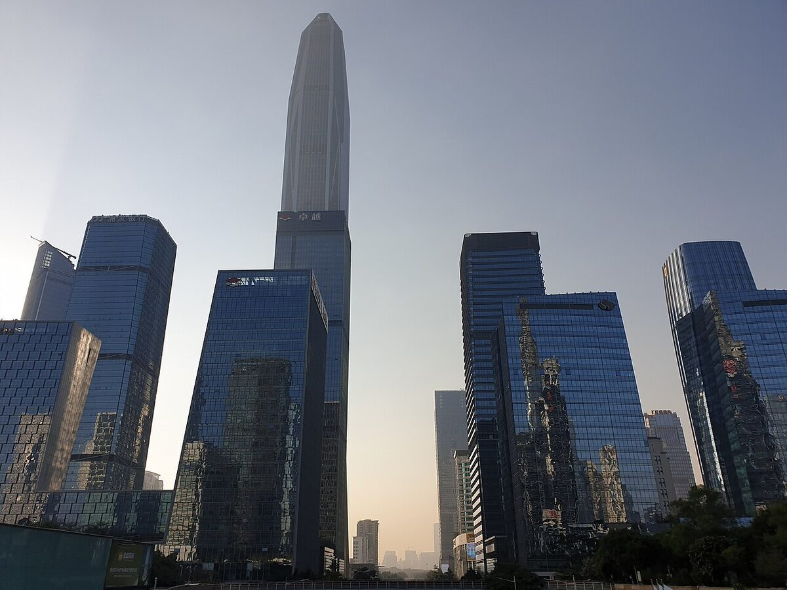
*Ping An International Finance Centre (平安金融中心), Futian CBD*
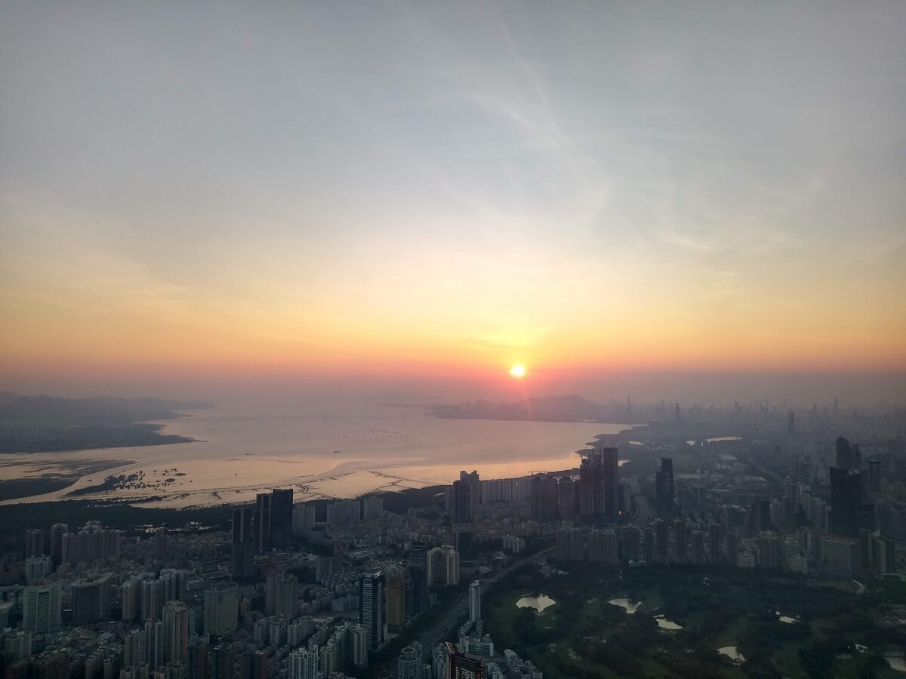
*From the 116F deck at sunset — Shenzhen Bay on the left, Futian below*

#### Fanny's review

> Ping An Financial Center is nearby the COCO Park shopping mall, no need to go there, just a commercial area, unless you want to go to COCO Park shopping mall.

Only the observation deck is worth paying for — the tower and its plaza are a commercial block. If you don't want the skyline ticket, skip it.

**Fun 8/10** · Futian · Observation deck · **1.36 km** from the hotel

- **Getting there:** L4 Futian Checkpoint → Convention & Exhibition Center → L1 Shopping Park (3 stops) (~16 min) or DiDi 8 min / 3.0 km, **¥13–17**.
- **Sweet spot:** 116F, the west/southwest corner windows about 30 min before sunset — you look straight down 益田路 and across to 莲花山公园. Do daylight → sunset → lights on one ¥180 ticket.
- **What to expect:** Airport-style security (bag scan), a 55-second lift, then an open 360° deck. 45–60 min inside. Buy online (¥180) instead of ¥200 at the counter.
- **Look out for:** Last entry 19:15, 20:15 on Fri/Sat. Haze after a humid day ruins the view — check the visibility before paying. No tripods.
- **Links:** [Amap pin](https://uri.amap.com/marker?position=114.055865,22.533096&name=Ping%27an%20International%20Financial%20Center&src=trip&coordinate=gaode&callnative=0) · [Amap route from hotel](https://uri.amap.com/navigation?from=114.05994,22.52147,Hotel&to=114.055865,22.533096,Ping%27an%20International%20Financial%20Center&mode=bus&coordinate=gaode&callnative=0) · [Google Maps](https://www.google.com/maps/place/Ping'an+International+Financial+Center/@22.5331818,113.9200248,12z/data=!4m10!1m3!11m2!2sit_Z1UV5ArUkUOq6M16oRQ!3e3!3m5!1s0x3403f403f3fd7827:0xad499e4e2a20c5db!8m2!3d22.533096!4d114.055865!16s%2Fm%2F09k5qh4?entry=ttu&g_ep=EgoyMDI2MTExOC4xIKXMDSoASAFQAw%3D%3D)
- **DiDi destination (copy this):**
  ```
  平安金融中心
  ```

### Museum of Contemporary Art & Planning Exhibition — 深圳当代艺术与城市规划馆

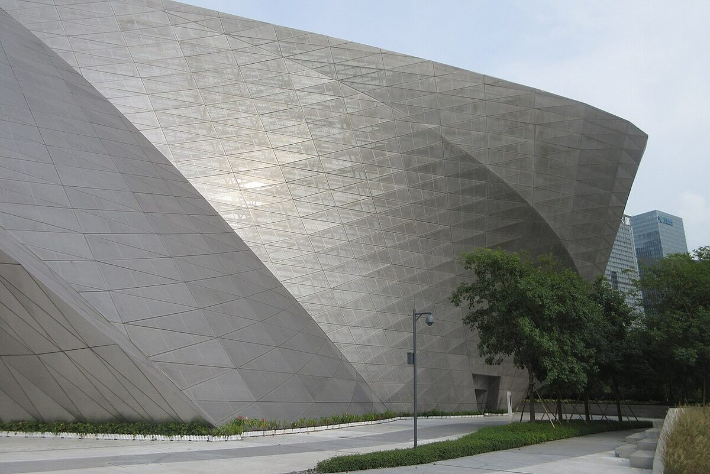
*Museum of Contemporary Art & Planning Exhibition (当代艺术与城市规划馆)*

**Fun 7/10** · Futian · Museum · **2.59 km** from the hotel

- **Getting there:** L4 Futian Checkpoint → Civic Center (3 stops) + 340 m walk (~18 min) or DiDi 12 min / 3.5 km, **¥15–19**.
- **Sweet spot:** The ground-floor atrium and the giant city-model hall (north wing, floors 3–5). The brushed-aluminium skin looks best in mid-afternoon light.
- **What to expect:** Free, no booking, Tue–Sun 10:00–18:00. Security x-ray at the door, 1–1.5 h inside. English captions are patchy; the model is the highlight.
- **Look out for:** Closed Mondays. Some touring exhibitions charge separately. No food or drink inside; free lockers at the entrance.
- **Links:** [Amap pin](https://uri.amap.com/marker?position=114.061277,22.544771&name=Museum%20of%20Contemporary%20Art%20%26%20Planning%20Exhibition&src=trip&coordinate=gaode&callnative=0) · [Amap route from hotel](https://uri.amap.com/navigation?from=114.05994,22.52147,Hotel&to=114.061277,22.544771,Museum%20of%20Contemporary%20Art%20%26%20Planning%20Exhibition&mode=bus&coordinate=gaode&callnative=0) · [Google Maps](https://www.google.com/maps/place/Museum+of+Contemporary+Art+%26+Planning+Exhibition/@22.544771,112.841795,9z/data=!4m10!1m3!11m2!2sit_Z1UV5ArUkUOq6M16oRQ!3e3!3m5!1s0x3403f5fedadbc56d:0x237bf856bb4e0137!8m2!3d22.544771!4d114.0612774!16s%2Fg%2F11h283g971?entry=ttu&g_ep=EgoyMDI2MTExOC4xIKXMDSoASAFQAw%3D%3D)
- **DiDi destination (copy this):**
  ```
  深圳当代艺术与城市规划馆
  ```

### WonderMeet — 玩美攻略

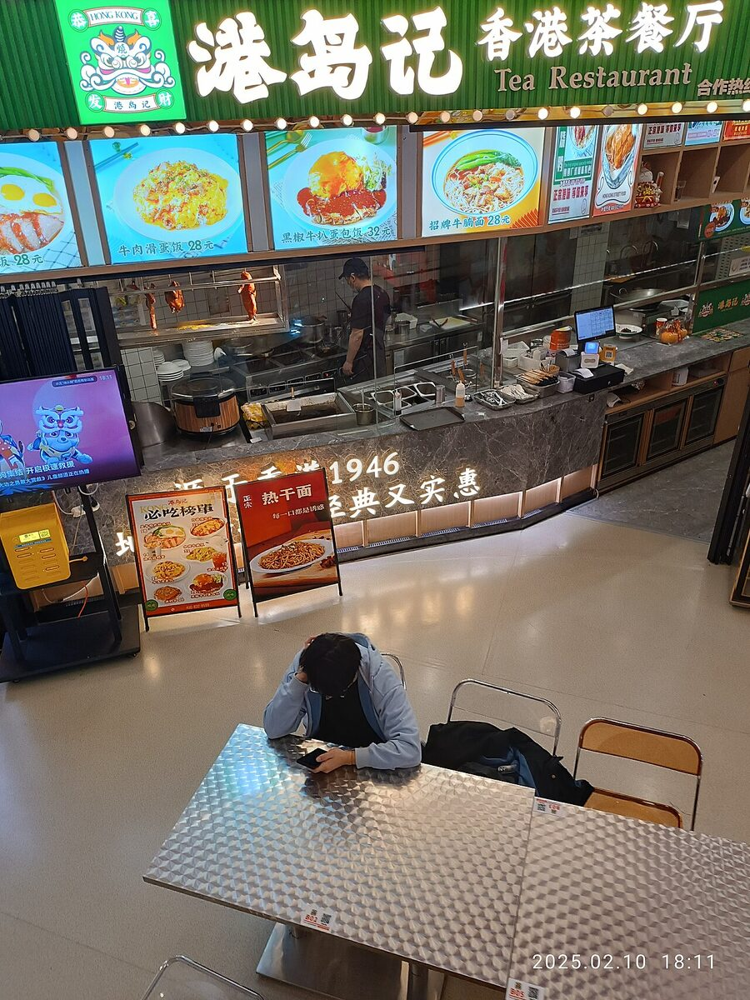
*Inside 世纪汇 (Century Place) — WonderMeet occupies levels 1–3*

**Fun 9/10** · Futian · Indoor mega-arcade (3 floors) · **3.32 km** from the hotel

- **Getting there:** L4 Futian Checkpoint → Convention & Exhibition Center → L1 Huaqiang Rd (2 + 2 stops) (~22 min) or DiDi 14 min / 5.6 km, **¥20–26**.
- **Sweet spot:** Start on **3F**: go-karts and laser tag before queues build, then 2F (ice rink, PS5/Switch, KTV pods), then 1F arcade as the afternoon fills.
- **What to expect:** One wristband, 10:00–22:00, **re-entry allowed** — leave for lunch and come back. 40+ activities over three levels (5F is a sauna). ¥268 weekday / ¥298 weekend; night pass ¥168 after 19:00.
- **Look out for:** Karts and laser tag need closed shoes; skates are rented. Weekday afternoons are quietest. Join their WeChat group at the desk for 20 free claw-machine coins.
- **Links:** [Amap pin](https://uri.amap.com/search?keyword=%E7%8E%A9%E7%BE%8E%E6%94%BB%E7%95%A5&city=%E6%B7%B1%E5%9C%B3&src=trip&callnative=0) · [Amap route from hotel](https://uri.amap.com/navigation?from=114.05994,22.52147,Hotel&to=114.084015,22.54146,WonderMeet&mode=bus&coordinate=gaode&callnative=0) · [Google Maps](https://www.google.com/maps/search/?api=1&query=22.54146,114.084015)
- **DiDi destination (copy this):**
  ```
  玩美攻略
  ```

### SEG Electronics Market — 赛格电子市场

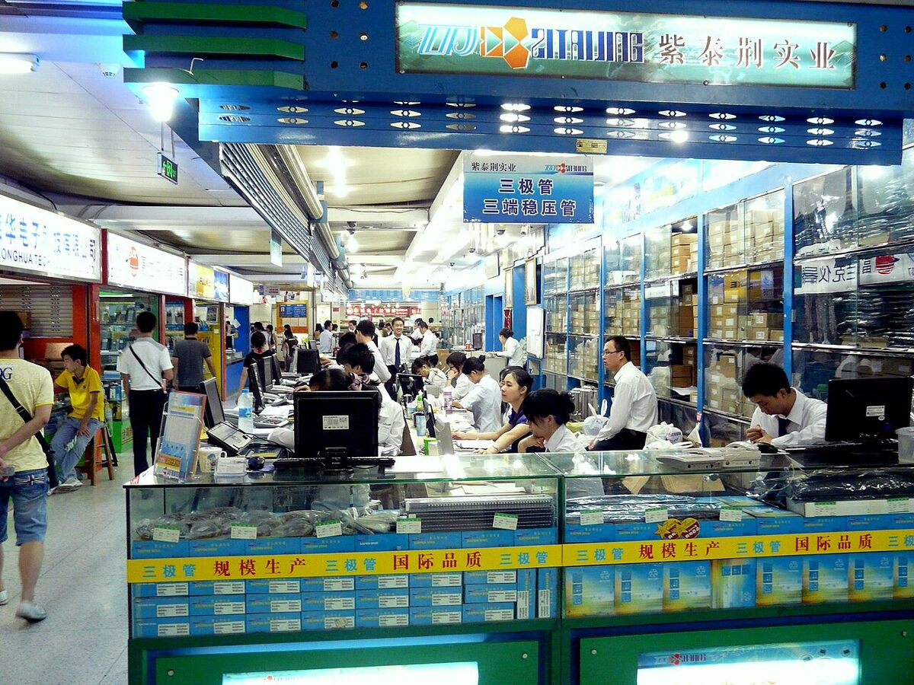
*Inside SEG Plaza (赛格) — six floors of components and repair benches*

**Fun 6/10** · Futian · Electronics wholesale · **3.39 km** from the hotel

- **Getting there:** L4 Futian Checkpoint → Convention & Exhibition Center → L1 Huaqiang Rd → walk 300 m (~22 min) or DiDi 14 min / 5.7 km, **¥20–26**.
- **Sweet spot:** Floors 1–3 for phones and laptops, the basement for components and tools. The repair benches are the real show.
- **What to expect:** Dense, loud, almost no English. Vendors quote fast — have the model number written on your phone. 45–90 min.
- **Look out for:** Check IMEI/serial and that it isn't refurbished. Know the Taobao price first, then bargain. Cash as backup.
- **Links:** [Amap pin](https://uri.amap.com/search?keyword=%E8%B5%9B%E6%A0%BC%E7%94%B5%E5%AD%90%E5%B8%82%E5%9C%BA&city=%E6%B7%B1%E5%9C%B3&src=trip&callnative=0) · [Amap route from hotel](https://uri.amap.com/navigation?from=114.05994,22.52147,Hotel&to=114.0822,22.54395,SEG%20Electronics%20Market&mode=bus&coordinate=gaode&callnative=0) · [Google Maps](https://www.google.com/maps/search/?api=1&query=22.54395,114.0822)
- **DiDi destination (copy this):**
  ```
  赛格电子市场
  ```

### Mingtong Cosmetics Market — 明通化妆品市场

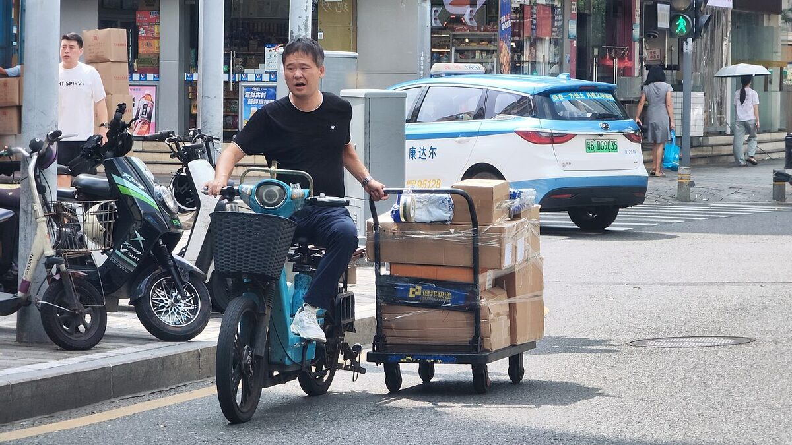
*The 华强北 wholesale grid — 明通 cosmetics is one of its towers*

**Fun 5/10** · Futian · Cosmetics wholesale · **3.98 km** from the hotel

- **Getting there:** L4 → Convention & Exhibition Center → L1 Huaqiang Rd → L7 华强北 (~26 min) or DiDi 17 min / 7.1 km, **¥23–30**.
- **Sweet spot:** Korean/Japanese skincare at near-duty-free prices. Ask for **批发价** (wholesale price) and buy three of something rather than one.
- **What to expect:** Tight stalls, pushy staff, 30–45 min. Branded goods are the draw.
- **Look out for:** Verify batch codes and expiry — some stock is grey-market. Very little haggling on brands.
- **Links:** [Amap pin](https://uri.amap.com/search?keyword=%E6%98%8E%E9%80%9A%E5%8C%96%E5%A6%86%E5%93%81%E5%B8%82%E5%9C%BA&city=%E6%B7%B1%E5%9C%B3&src=trip&callnative=0) · [Amap route from hotel](https://uri.amap.com/navigation?from=114.05994,22.52147,Hotel&to=114.089,22.5452,Mingtong%20Cosmetics%20Market&mode=bus&coordinate=gaode&callnative=0) · [Google Maps](https://www.google.com/maps/search/?api=1&query=22.5452,114.089)
- **DiDi destination (copy this):**
  ```
  明通化妆品市场
  ```

### Upper Hills (深业上城)

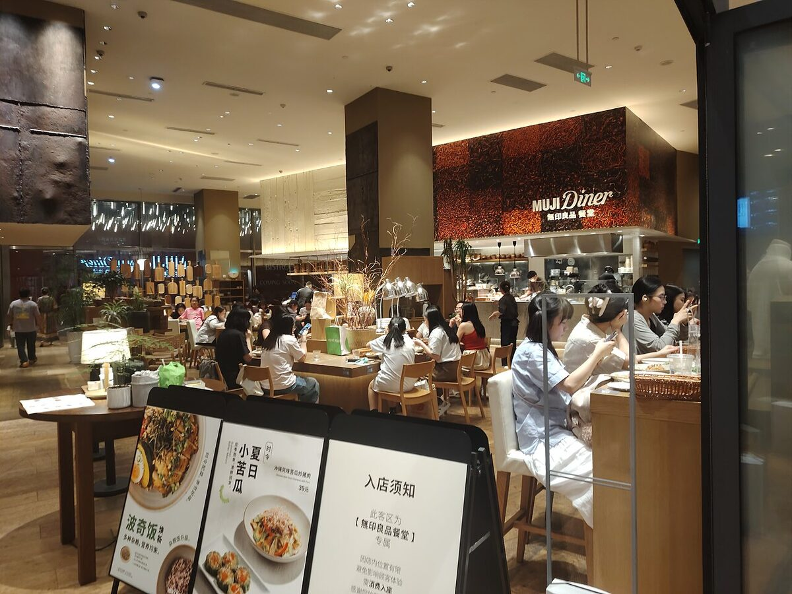
*MUJI Diner at Upper Hills (深业上城)*
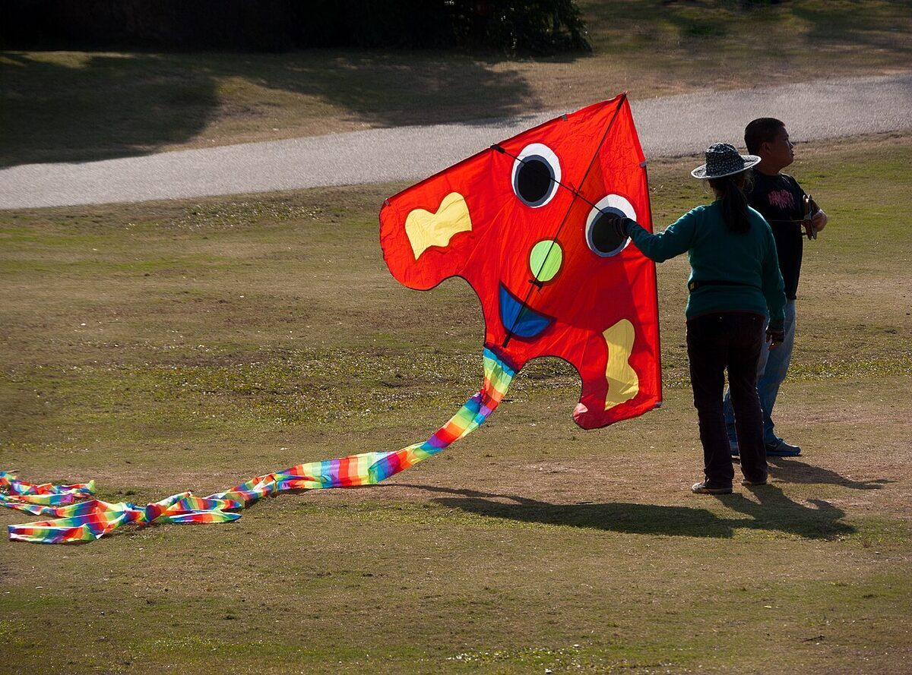
*莲花山公园 (Lianhuashan Park) — the park at the end of the bridge*
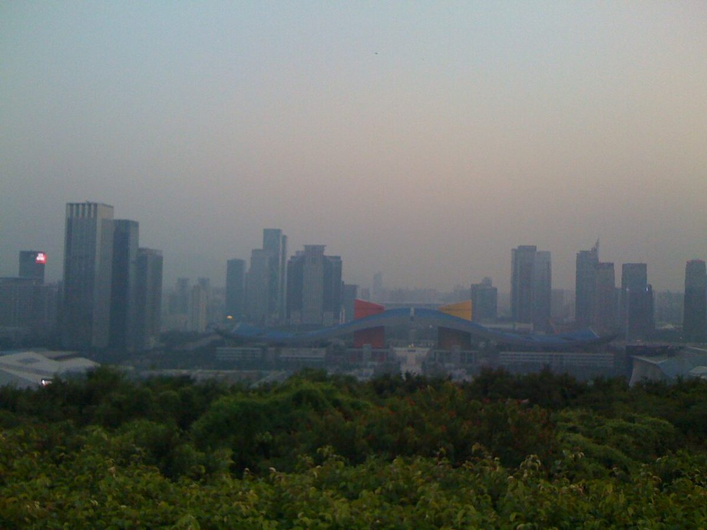
*Dusk over the Futian CBD from the top of 莲花山公园*

**Fun 7/10** · Futian · Lifestyle mall + park bridge · **4.03 km** from the hotel

- **Getting there:** L10 Futian Checkpoint → Donggualing (5 stops, direct) (~25 min) or DiDi 14 min / 5.6 km, **¥20–26**.
- **Sweet spot:** The loft lanes and coffee terraces, then the footbridge into 莲花山公园 — a 15–20 min climb to the Deng Xiaoping statue for the classic CBD skyline at sunset, free.
- **What to expect:** An open-air mall (MUJI Hotel/Diner, duty-free, design shops) plus a big park. 2–3 h if you do both. This is the best free sunset in the city.
- **Look out for:** The bridge and park climb are unshaded — go after 16:00. Few toilets near the summit. The mall is quiet on weekday mornings.
- **Links:** [Amap pin](https://uri.amap.com/marker?position=114.070537,22.556332&name=Upper%20Hills%20%28%E6%B7%B1%E4%B8%9A%E4%B8%8A%E5%9F%8E%29&src=trip&coordinate=gaode&callnative=0) · [Amap route from hotel](https://uri.amap.com/navigation?from=114.05994,22.52147,Hotel&to=114.070537,22.556332,Upper%20Hills%20%28%E6%B7%B1%E4%B8%9A%E4%B8%8A%E5%9F%8E%29&mode=bus&coordinate=gaode&callnative=0) · [Google Maps](https://www.google.com/maps/place/%E6%B7%B1%E4%B8%9A%E4%B8%8A%E5%9F%8E/@22.5563318,114.070537,17z/data=!4m7!3m6!1s0x3403f5d813dfb6b9:0x7a85f14e08f5bce0!8m2!3d22.5563318!4d114.070537!16s%2Fg%2F11fhz0ljjc)
- **DiDi destination (copy this):**
  ```
  深业上城
  ```

### Zijingcheng Food Center — 紫荆城食品交易中心

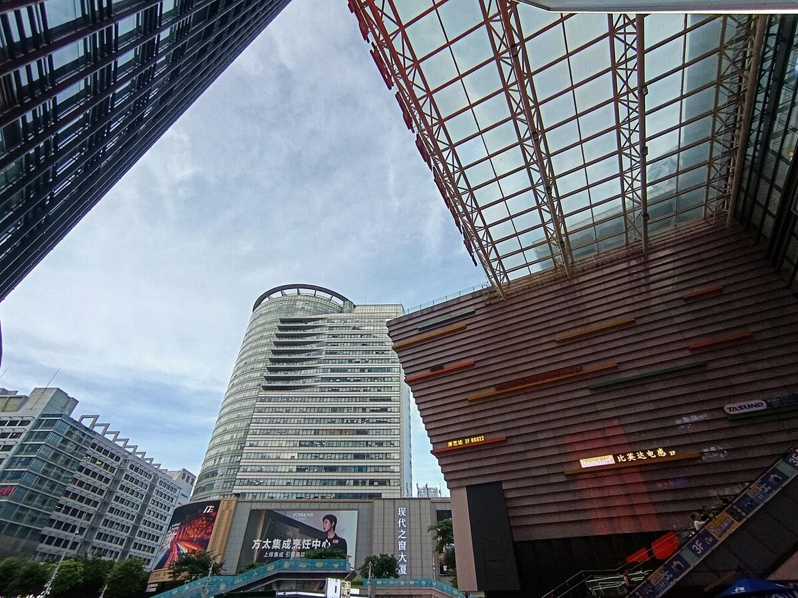
*华强北 — the block that 紫荆城食品交易中心 sits in*

**Fun 6/10** · Futian · Imported food wholesale · **4.04 km** from the hotel

- **Getting there:** L4 → Convention & Exhibition Center → L1 Huaqiang Rd → walk 400 m (~24 min) or DiDi 17 min / 7.0 km, **¥23–30**.
- **Sweet spot:** Two floors of imported snacks: buy a **box** of nuts or a case of drinks, not singles.
- **What to expect:** 100+ stalls, wholesale prices even for one item. 30–45 min.
- **Look out for:** Check the expiry on the box, not the sample. Cards work, cash gets a better number.
- **Links:** [Amap pin](https://uri.amap.com/search?keyword=%E7%B4%AB%E8%8D%86%E5%9F%8E%E9%A3%9F%E5%93%81%E4%BA%A4%E6%98%93%E4%B8%AD%E5%BF%83&city=%E6%B7%B1%E5%9C%B3&src=trip&callnative=0) · [Amap route from hotel](https://uri.amap.com/navigation?from=114.05994,22.52147,Hotel&to=114.0888,22.5461,Zijingcheng%20Food%20Center&mode=bus&coordinate=gaode&callnative=0) · [Google Maps](https://www.google.com/maps/search/?api=1&query=22.5461,114.0888)
- **DiDi destination (copy this):**
  ```
  紫荆城食品交易中心
  ```

### Shenzhen Cultural Center (Jingtian) — 深圳市文化馆


**Fun 3/10** · Futian · Arts venue · **4.11 km** from the hotel

- **Getting there:** L4 Futian Checkpoint → Civic Center → L2 Jingtian (3 + 3 stops) (~28 min) or DiDi 16 min / 6.4 km, **¥22–28**.
- **Sweet spot:** Whatever is on that week — it's a working arts centre, not a sight.
- **What to expect:** A neighbourhood venue in 景田; small exhibitions and performances.
- **Look out for:** Check the programme first; parts close on Mondays. Easy to skip on a 3-day trip.
- **Links:** [Amap pin](https://uri.amap.com/marker?position=114.043557,22.55523&name=Shenzhen%20Cultural%20Center%20%28Jingtian%29&src=trip&coordinate=gaode&callnative=0) · [Amap route from hotel](https://uri.amap.com/navigation?from=114.05994,22.52147,Hotel&to=114.043557,22.55523,Shenzhen%20Cultural%20Center%20%28Jingtian%29&mode=bus&coordinate=gaode&callnative=0) · [Google Maps](https://www.google.com/maps/place/Shenzhen+Cultural+Center/@22.55523,112.8240746,9z/data=!4m10!1m3!11m2!2sit_Z1UV5ArUkUOq6M16oRQ!3e3!3m5!1s0x3403f38b835cc389:0xd796ef4f35c4b1cc!8m2!3d22.55523!4d114.043557!16s%2Fm%2F04ldglg?entry=ttu&g_ep=EgoyMDI2MTExOC4xIKXMDSoASAFQAw%3D%3D)
- **DiDi destination (copy this):**
  ```
  深圳市文化馆
  ```

### Shenzhen Grand Theatre — 深圳大剧院

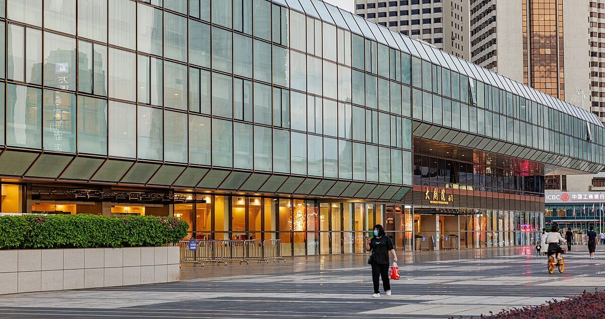
*Shenzhen Grand Theatre (深圳大剧院)*

**Fun 4/10** · Luohu · Performing arts · **5.24 km** from the hotel

- **Getting there:** L4 Futian Checkpoint → Civic Center → L2 Grand Theater (3 + 4 stops) (~28 min) or DiDi 19 min / 7.2 km, **¥23–31**.
- **Sweet spot:** The glass lobby lit up before a performance.
- **What to expect:** A ticketed concert/ theatre house; without a ticket it's a 5-minute look.
- **Look out for:** Don't build a day around it unless you've booked a show — check 大麦/Damai for that week.
- **Links:** [Amap pin](https://uri.amap.com/marker?position=114.10546,22.542692&name=Shenzhen%20Grand%20Theatre&src=trip&coordinate=gaode&callnative=0) · [Amap route from hotel](https://uri.amap.com/navigation?from=114.05994,22.52147,Hotel&to=114.10546,22.542692,Shenzhen%20Grand%20Theatre&mode=bus&coordinate=gaode&callnative=0) · [Google Maps](https://www.google.com/maps/place/Shenzhen+Grand+Theatre/@22.542692,112.8859776,9z/data=!4m10!1m3!11m2!2sit_Z1UV5ArUkUOq6M16oRQ!3e3!3m5!1s0x3403f5b7d46a8e0b:0x9656bf8761859c01!8m2!3d22.542692!4d114.10546!16s%2Fg%2F11x1nm6_8?entry=ttu&g_ep=EgoyMDI2MTExOC4xIKXMDSoASAFQAw%3D%3D)
- **DiDi destination (copy this):**
  ```
  深圳大剧院
  ```

### The Mixc of Shenzhen City Crossing — 深圳万象城

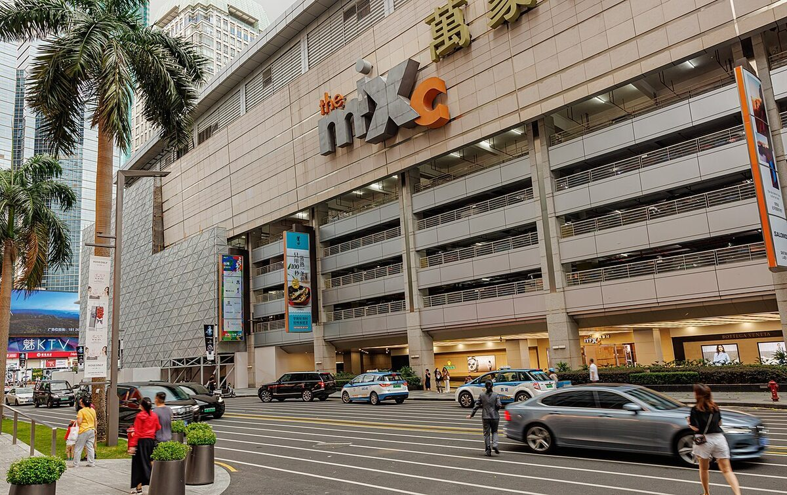
*The MixC (深圳万象城), Luohu*

**Fun 5/10** · Luohu · Luxury mall · **5.62 km** from the hotel

- **Getting there:** L4 Futian Checkpoint → Civic Center → L2 Grand Theater (3 + 4 stops) (~28 min) or DiDi 21 min / 8.1 km, **¥26–33**.
- **Sweet spot:** The luxury atrium and the basement food hall — the reliable rain plan.
- **What to expect:** 1–2 h of shopping; clean, English-friendly, air-conditioned.
- **Look out for:** It's a mall, not a landmark. Prices are Hong Kong-level.
- **Links:** [Amap pin](https://uri.amap.com/marker?position=114.110904,22.539827&name=The%20Mixc%20of%20Shenzhen%20City%20Crossing&src=trip&coordinate=gaode&callnative=0) · [Amap route from hotel](https://uri.amap.com/navigation?from=114.05994,22.52147,Hotel&to=114.110904,22.539827,The%20Mixc%20of%20Shenzhen%20City%20Crossing&mode=bus&coordinate=gaode&callnative=0) · [Google Maps](https://www.google.com/maps/place/The+Mixc+of+Shenzhen+City+Crossing/@22.539827,112.8914216,9z/data=!4m10!1m3!11m2!2sit_Z1UV5ArUkUOq6M16oRQ!3e3!3m5!1s0x3403f5c7a7397263:0xc0cfcceb6dc86221!8m2!3d22.539827!4d114.110904!16s%2Fg%2F1tfq6v3k?entry=ttu&g_ep=EgoyMDI2MTExOC4xIKXMDSoASAFQAw%3D%3D)
- **DiDi destination (copy this):**
  ```
  深圳万象城
  ```

### Dong Men Ding Plaza — 东门町广场

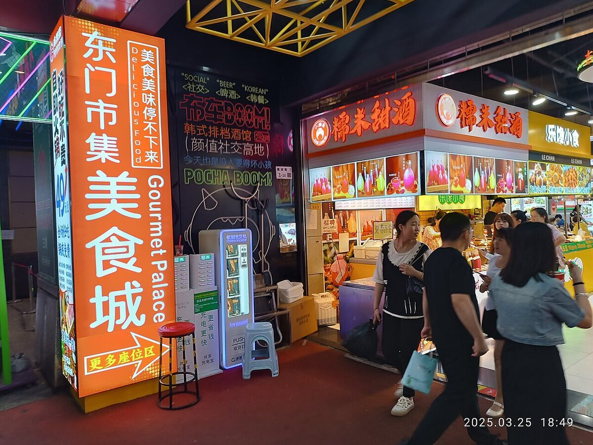
*Food hall inside Dongmen (东门町广场)*

**Fun 3/10** · Luohu · Shopping mall · **6.55 km** from the hotel

- **Getting there:** As DMD Food City, then 230 m walk (~31 min) or DiDi 25 min / 9.5 km, **¥29–38**.
- **Sweet spot:** Nothing of its own — it's the covered shortcut into the food city.
- **What to expect:** A generic mall attached to DMD Food City.
- **Look out for:** Skip unless it's raining or you need AC.
- **Links:** [Amap pin](https://uri.amap.com/marker?position=114.118764,22.544242&name=Dong%20Men%20Ding%20Plaza&src=trip&coordinate=gaode&callnative=0) · [Amap route from hotel](https://uri.amap.com/navigation?from=114.05994,22.52147,Hotel&to=114.118764,22.544242,Dong%20Men%20Ding%20Plaza&mode=bus&coordinate=gaode&callnative=0) · [Google Maps](https://www.google.com/maps/place/Dong+Men+Ding+Plaza/@22.5442424,112.8992816,9z/data=!4m10!1m3!11m2!2sit_Z1UV5ArUkUOq6M16oRQ!3e3!3m5!1s0x3403f5be47383aeb:0xc74e4979a2fa154e!8m2!3d22.5442424!4d114.118764!16s%2Fg%2F1tznjz4j?entry=ttu&g_ep=EgoyMDI2MTExOC4xIKXMDSoASAFQAw%3D%3D)
- **DiDi destination (copy this):**
  ```
  东门町广场
  ```

### DMD Food City (东门町美食城)

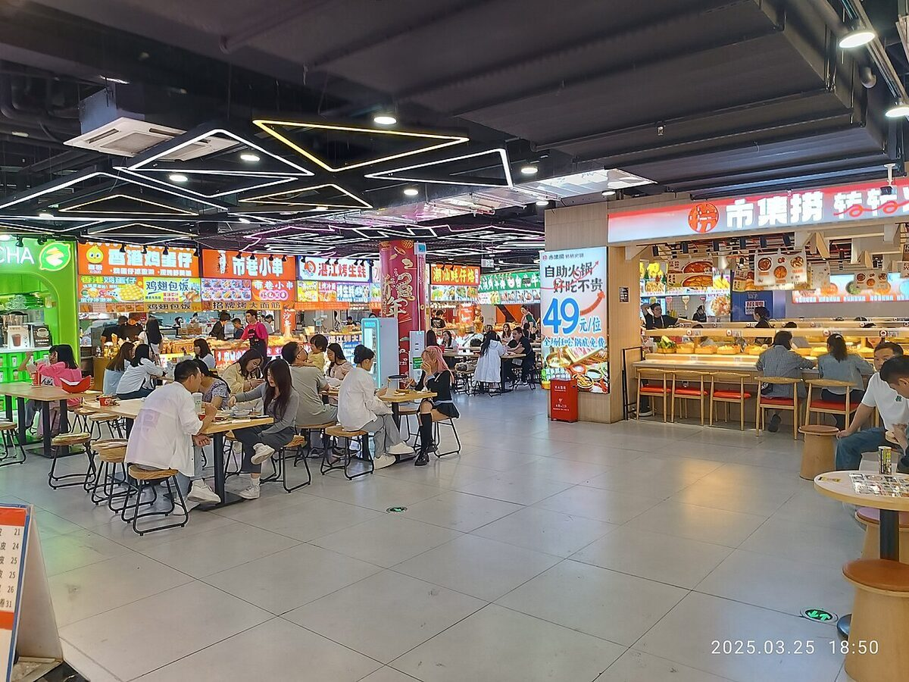
*东门町美食城 (DMD Food City), Dongmen*

**Fun 7/10** · Luohu · Street-food hall · **6.59 km** from the hotel

- **Getting there:** L4 Futian Checkpoint → Convention & Exhibition Center → L1 Laojie (2 + 5 stops) (~30 min) or DiDi 25 min / 9.4 km, **¥29–37**.
- **Sweet spot:** The back stall rows: 潮汕 beef balls, 生煎 buns, 糖水 desserts. Order by pointing; most stalls take WeChat/Alipay only.
- **What to expect:** Loud, bright, crowded. ¥15–40 a dish, shared tables, 45–90 min. The cheapest good eating on this list.
- **Look out for:** Peak 18:00–20:00 — go 17:00 or 20:30. Some stalls shut early on weekdays. Cash is often refused.
- **Links:** [Amap pin](https://uri.amap.com/marker?position=114.11894,22.544816&name=DMD%20Food%20City%20%28%E4%B8%9C%E9%97%A8%E7%94%BA%E7%BE%8E%E9%A3%9F%E5%9F%8E%29&src=trip&coordinate=gaode&callnative=0) · [Amap route from hotel](https://uri.amap.com/navigation?from=114.05994,22.52147,Hotel&to=114.11894,22.544816,DMD%20Food%20City%20%28%E4%B8%9C%E9%97%A8%E7%94%BA%E7%BE%8E%E9%A3%9F%E5%9F%8E%29&mode=bus&coordinate=gaode&callnative=0) · [Google Maps](https://www.google.com/maps/place/DMD+Food+City/@22.544816,112.8994574,9z/data=!4m10!1m3!11m2!2sit_Z1UV5ArUkUOq6M16oRQ!3e3!3m5!1s0x3403f5be1444dc89:0x5c89f1e03796e0f8!8m2!3d22.544816!4d114.1189398!16s%2Fg%2F11xlkt3zg?entry=ttu&g_ep=EgoyMDI2MTExOC4xIKXMDSoASAFQAw%3D%3D)
- **DiDi destination (copy this):**
  ```
  东门町美食城
  ```

### Dongmen Pedestrian Street — 东门步行街


*Dongmen Pedestrian Street (东门步行街) at night*

**Fun 6/10** · Luohu · Shopping street · **6.77 km** from the hotel

- **Getting there:** L4 Futian Checkpoint → Civic Center → L2 Hubei (3 + 5 stops) (~32 min) or DiDi 25 min / 9.7 km, **¥29–38**.
- **Sweet spot:** The neon at dusk, then the side lanes off 解放路 for snacks.
- **What to expect:** Shenzhen's original bargain street: clothes, phone cases, skewers, huge crowds. 1–2 h.
- **Look out for:** Ignore anyone inviting you to a "tea ceremony" or "art show" — classic scam. Keep your phone zipped; it's shoulder-to-shoulder on weekends.
- **Links:** [Amap pin](https://uri.amap.com/marker?position=114.120344,22.545938&name=Dongmen%20Pedestrian%20Street&src=trip&coordinate=gaode&callnative=0) · [Amap route from hotel](https://uri.amap.com/navigation?from=114.05994,22.52147,Hotel&to=114.120344,22.545938,Dongmen%20Pedestrian%20Street&mode=bus&coordinate=gaode&callnative=0) · [Google Maps](https://www.google.com/maps/place/Shenzhen+Dongmen+Commercial+Pedestrian+Street+Unit+Management+Office/@22.545938,112.9008616,9z/data=!4m10!1m3!11m2!2sit_Z1UV5ArUkUOq6M16oRQ!3e3!3m5!1s0x3403f596017f6bf7:0x845ce96dbee1b478!8m2!3d22.545938!4d114.120344!16s%2Fg%2F1tmqctqv?entry=ttu&g_ep=EgoyMDI2MTExOC4xIKXMDSoASAFQAw%3D%3D)
- **DiDi destination (copy this):**
  ```
  东门步行街
  ```

### Dongmen Baima Fashion Market — 东门白马服装市场

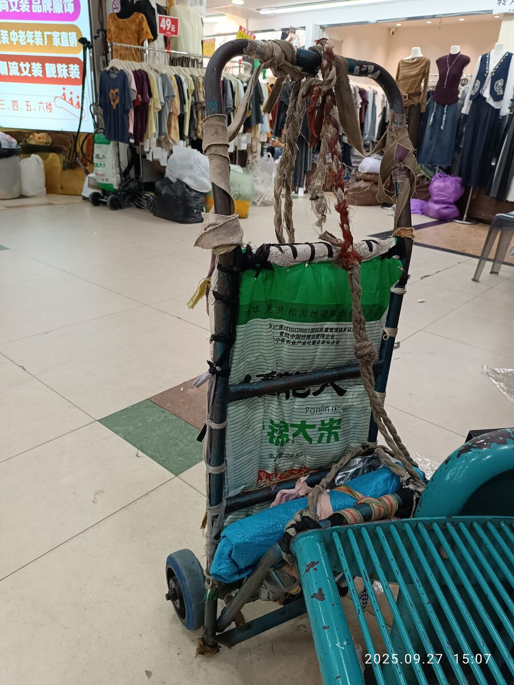
*Wholesale clothing floors around 老街 — 白马 / 宝华楼*

**Fun 5/10** · Luohu · Clothing wholesale · **6.77 km** from the hotel

- **Getting there:** L1 Laojie from Huaqiang Rd (2 stops) (~30 min) or DiDi 25 min / 9.7 km, **¥29–38**.
- **Sweet spot:** **2F** women's trend, 3–4F men's, **5F export surplus**. Hit it 16:00–18:00 as they clear stock.
- **What to expect:** Six floors, 500+ stalls; some want two or three pieces minimum. 1–1.5 h.
- **Look out for:** Sizes run small — try before paying. Walking away is your strongest move.
- **Links:** [Amap pin](https://uri.amap.com/search?keyword=%E4%B8%9C%E9%97%A8%E7%99%BD%E9%A9%AC%E6%9C%8D%E8%A3%85%E5%B8%82%E5%9C%BA&city=%E6%B7%B1%E5%9C%B3&src=trip&callnative=0) · [Amap route from hotel](https://uri.amap.com/navigation?from=114.05994,22.52147,Hotel&to=114.120344,22.545938,Dongmen%20Baima%20Fashion%20Market&mode=bus&coordinate=gaode&callnative=0) · [Google Maps](https://www.google.com/maps/search/?api=1&query=22.545938,114.120344)
- **DiDi destination (copy this):**
  ```
  东门白马服装市场
  ```

### Shuibei Jewelry Center — 水贝国际珠宝交易中心

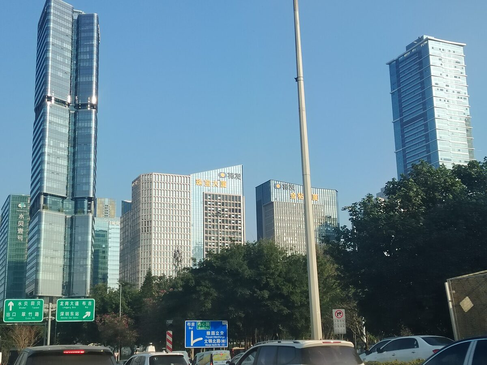
*特发水贝珠宝大厦 — one of the Shuibei jewelry towers*

**Fun 6/10** · Luohu · Gold & jade wholesale · **8.53 km** from the hotel

- **Getting there:** L7 Huanggangcun → 水贝 (5 stops, direct) + 10 min walk (~25 min) or DiDi 25 min / 13.9 km, **¥40–51**.
- **Sweet spot:** Price = **gold weight × the day's rate + 工费 (labour)**. Ask for both numbers separately, then compare two or three towers on the same street.
- **What to expect:** Showrooms rather than stalls; staff will weigh and quote without pressure. 1–1.5 h. Weekdays are calmer than weekends.
- **Look out for:** Insist on the certificate and a receipt, and check the 工费 isn't padded. Don't buy jade without a loupe and a second opinion.
- **Links:** [Amap pin](https://uri.amap.com/search?keyword=%E6%B0%B4%E8%B4%9D%E5%9B%BD%E9%99%85%E7%8F%A0%E5%AE%9D%E4%BA%A4%E6%98%93%E4%B8%AD%E5%BF%83&city=%E6%B7%B1%E5%9C%B3&src=trip&callnative=0) · [Amap route from hotel](https://uri.amap.com/navigation?from=114.05994,22.52147,Hotel&to=114.1274,22.5662,Shuibei%20Jewelry%20Center&mode=bus&coordinate=gaode&callnative=0) · [Google Maps](https://www.google.com/maps/search/?api=1&query=22.5662,114.1274)
- **DiDi destination (copy this):**
  ```
  水贝国际珠宝交易中心
  ```

### MixC World 万象天地 (Nanshan)

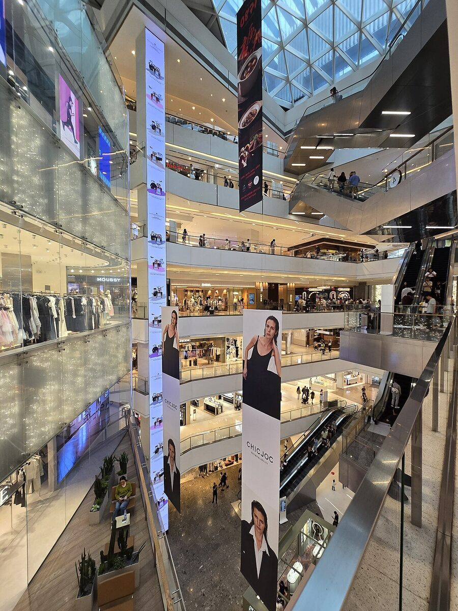
*MIXC WORLD / 万象天地, Nanshan*

**Fun 7/10** · Nanshan · Lifestyle mall · **10.95 km** from the hotel

- **Getting there:** L7 Huanggangcun → Chegongmiao → L1 Hi-Tech Park (4 + 6 stops) (~40 min) or DiDi 23 min / 16.6 km, **¥46–60**.
- **Sweet spot:** The outdoor 里巷 lanes and sunken plaza — best coffee-and-dessert stop in the city.
- **What to expect:** Design-led mall, 1–2 h, English menus common.
- **Look out for:** Popular restaurants queue 45 min+ at weekends — reserve on 大众点评 (Dianping) first.
- **Links:** [Amap pin](https://uri.amap.com/marker?position=113.955538,22.541563&name=MixC%20World%20%E4%B8%87%E8%B1%A1%E5%A4%A9%E5%9C%B0%20%28Nanshan%29&src=trip&coordinate=gaode&callnative=0) · [Amap route from hotel](https://uri.amap.com/navigation?from=114.05994,22.52147,Hotel&to=113.955538,22.541563,MixC%20World%20%E4%B8%87%E8%B1%A1%E5%A4%A9%E5%9C%B0%20%28Nanshan%29&mode=bus&coordinate=gaode&callnative=0) · [Google Maps](https://www.google.com/maps/place/%E8%90%AC%E8%B1%A1%E5%A4%A9%E5%9C%B0+The+Mixc/@22.5415629,112.7360555,9z/data=!4m10!1m3!11m2!2sit_Z1UV5ArUkUOq6M16oRQ!3e3!3m5!1s0x3403f1af79f8136b:0x1d2a318dc6483fa4!8m2!3d22.5415629!4d113.9555379!16s%2Fg%2F11ffvsc1km?entry=ttu&g_ep=EgoyMDI2MTExOC4xIKXMDSoASAFQAw%3D%3D)
- **DiDi destination (copy this):**
  ```
  万象天地
  ```

### Shenzhen Talent Park — 深圳人才公园

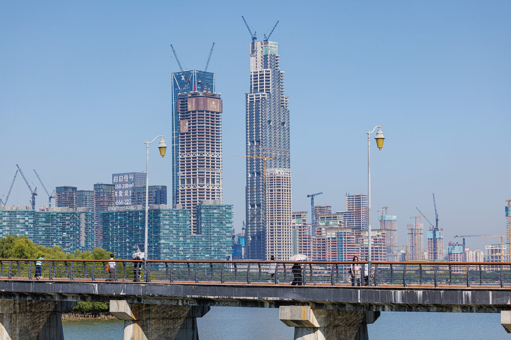
*Shenzhen Talent Park (深圳人才公园) and the Houhai skyline*
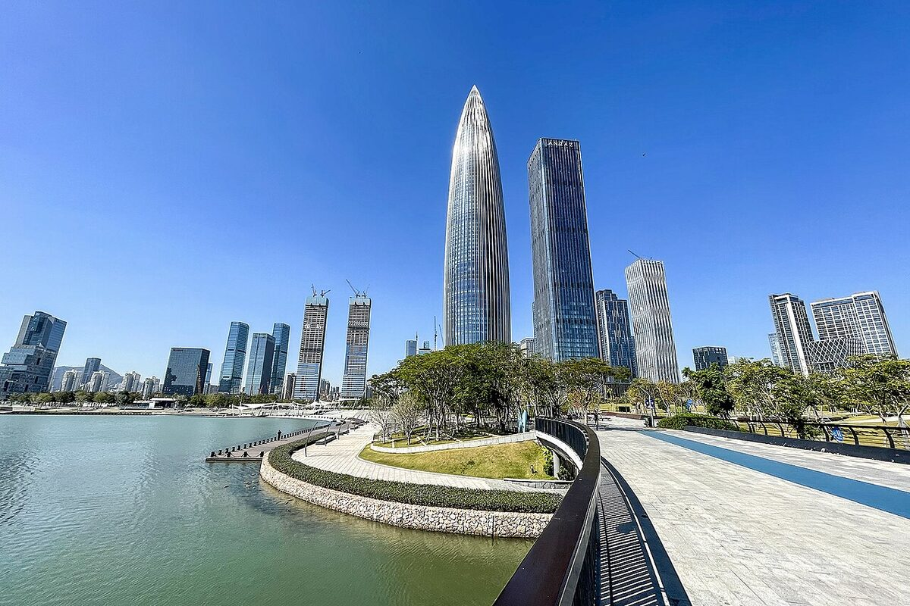
*The Shenzhen Bay skyline from the Talent Park waterfront*

**Fun 8/10** · Nanshan · Waterfront park · **11.74 km** from the hotel

- **Getting there:** L7 Huanggangcun → Chegongmiao → L11 Houhai → L13 Talent Park (~45 min) or DiDi 25 min / 16.5 km, **¥46–60**.
- **Sweet spot:** The wooden boardwalk on the west side, looking back at 春笋 and the Houhai towers. 17:00–18:30 is the light you want.
- **What to expect:** Free, flat ~2.5 km loop, 45–60 min. Locals run and fish here; it's calm on weekdays.
- **Look out for:** Little shade; mosquitoes after dusk. The metro exit is a 10-min walk from the water.
- **Links:** [Amap pin](https://uri.amap.com/marker?position=113.946226,22.511216&name=Shenzhen%20Talent%20Park&src=trip&coordinate=gaode&callnative=0) · [Amap route from hotel](https://uri.amap.com/navigation?from=114.05994,22.52147,Hotel&to=113.946226,22.511216,Shenzhen%20Talent%20Park&mode=bus&coordinate=gaode&callnative=0) · [Google Maps](https://www.google.com/maps/place/Shenzhen+Talent+Park/@22.5112161,112.7267433,9z/data=!4m10!1m3!11m2!2sit_Z1UV5ArUkUOq6M16oRQ!3e3!3m5!1s0x3403ef3288f2af21:0xcade8137080c45f1!8m2!3d22.5112161!4d113.9462257!16s%2Fg%2F11fj3dngyw?entry=ttu&g_ep=EgoyMDI2MTExOC4xIKXMDSoASAFQAw%3D%3D)
- **DiDi destination (copy this):**
  ```
  深圳人才公园
  ```

### Shenzhen Poly Cultural Plaza — 深圳保利文化广场


*Houhai skyline — Poly Cultural Plaza (保利文化广场) sits at its foot*

**Fun 3/10** · Nanshan · Mall + theatre · **12.45 km** from the hotel

- **Getting there:** L7 Huanggangcun → Chegongmiao → L11 Houhai (4 + 2 stops) (~40 min) or DiDi 23 min / 16.3 km, **¥45–59**.
- **Sweet spot:** Only if a show is on at the theatre.
- **What to expect:** A local mall and theatre next to Talent Park.
- **Look out for:** Skip as a destination; use it for AC or dinner after the park.
- **Links:** [Amap pin](https://uri.amap.com/marker?position=113.93887,22.516386&name=Shenzhen%20Poly%20Cultural%20Plaza&src=trip&coordinate=gaode&callnative=0) · [Amap route from hotel](https://uri.amap.com/navigation?from=114.05994,22.52147,Hotel&to=113.93887,22.516386,Shenzhen%20Poly%20Cultural%20Plaza&mode=bus&coordinate=gaode&callnative=0) · [Google Maps](https://www.google.com/maps/place/Shenzhen+Poly+Cultural+Plaza,+%E5%AE%9D%E5%AE%89%E4%B8%AD%E5%BF%83%E5%8C%BA+Nan+Shan+Qu,+Shen+Zhen+Shi,+Guang+Dong+Sheng,+China,+518064/@22.5163863,112.7193876,9z/data=!4m10!1m3!11m2!2sit_Z1UV5ArUkUOq6M16oRQ!3e3!3m5!1s0x3403ee3b74672d0f:0x2802395723eebd84!8m2!3d22.5163863!4d113.93887!16s%2Fg%2F12xpyqy4c?entry=ttu&g_ep=EgoyMDI2MTExOC4xIKXMDSoASAFQAw%3D%3D)
- **DiDi destination (copy this):**
  ```
  深圳保利文化广场
  ```

### Nanyou Clothing Market — 南油服装批发市场


**Fun 6/10** · Nanshan · Designer clothing wholesale · **13.94 km** from the hotel

- **Getting there:** L11 Chegongmiao → 南油 (3 stops) or DiDi (~40 min) or DiDi 25 min / 18.5 km, **¥51–66**.
- **Sweet spot:** Dozens of buildings of original-design women's wear in the 南海大道 / 东滨路 grid — the best-quality clothing market in the city.
- **What to expect:** Higher grade than 白马 at 3–5× the price. 10:00–19:00, 1.5–2 h.
- **Look out for:** 25 min each way from the hotel in the wrong direction — only if clothing is the goal; skip 水贝 if you go.
- **Links:** [Amap pin](https://uri.amap.com/search?keyword=%E5%8D%97%E6%B2%B9%E6%9C%8D%E8%A3%85%E6%89%B9%E5%8F%91%E5%B8%82%E5%9C%BA&city=%E6%B7%B1%E5%9C%B3&src=trip&callnative=0) · [Amap route from hotel](https://uri.amap.com/navigation?from=114.05994,22.52147,Hotel&to=113.924947,22.50905,Nanyou%20Clothing%20Market&mode=bus&coordinate=gaode&callnative=0) · [Google Maps](https://www.google.com/maps/search/?api=1&query=22.50905,113.924947)
- **DiDi destination (copy this):**
  ```
  南油服装批发市场
  ```

### Nantou Ancient City — 南头古城


*South gate of Nantou Ancient City (南头古城)*

#### Fanny's review

> I went to Nantou Ancient City with Heidi, it's not very interesting, they turn this place to a pedestrian street, both sides are small shops and the street is not very long.

**Skip it.** The weakest thing on this list — your contact's verdict, not mine.

**Fun 5/10** · Nanshan · Historic quarter · **14.49 km** from the hotel

- **Getting there:** L7 Huanggangcun → Chegongmiao → L1 Taoyuan → L12 Nantou Ancient City (2 changes) (~55 min) or DiDi 24 min / 21.7 km, **¥58–76**.
- **Sweet spot:** The south gate and main lane, plus coffee in the restored courtyard houses.
- **What to expect:** 1.5–2 h at most — and only if you want a coffee stop.
- **Look out for:** If you go anyway, go for coffee in a restored courtyard, not for sightseeing, and only on a weekday — weekends are packed and the shops repeat.
- **Links:** [Amap pin](https://uri.amap.com/marker?position=113.920489,22.541119&name=Nantou%20Ancient%20City&src=trip&coordinate=gaode&callnative=0) · [Amap route from hotel](https://uri.amap.com/navigation?from=114.05994,22.52147,Hotel&to=113.920489,22.541119,Nantou%20Ancient%20City&mode=bus&coordinate=gaode&callnative=0) · [Google Maps](https://www.google.com/maps/place/Nantou+Ancient+City/@22.541119,112.7010066,9z/data=!4m10!1m3!11m2!2sit_Z1UV5ArUkUOq6M16oRQ!3e3!3m5!1s0x3403ee7055e55f1d:0xf15bf63d2ac63f6f!8m2!3d22.541119!4d113.920489!16s%2Fg%2F1pxyjfh9r?entry=ttu&g_ep=EgoyMDI2MTExOC4xIKXMDSoASAFQAw%3D%3D)
- **DiDi destination (copy this):**
  ```
  南头古城
  ```

### Happy Harbour — 欢乐港湾

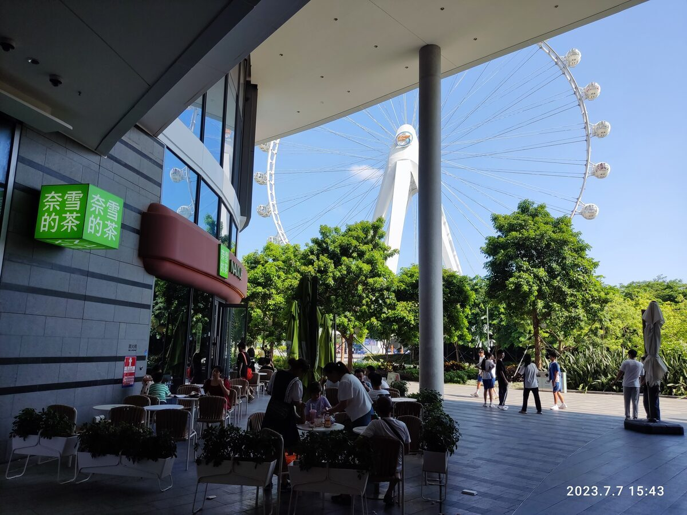
*Happy Harbour (欢乐港湾) and the Bay Glory wheel, Bao'an*
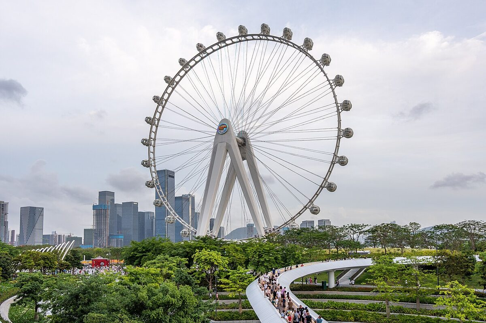
*Bay Glory (湾区之光), 128 m, on the Bao'an waterfront*

**Fun 8/10** · Bao'an · Waterfront + ferris wheel · **18.2 km** from the hotel

- **Getting there:** L7 Huanggangcun → Chegongmiao → L11 Qianhai Bay → L5 Linhai (~50 min) or DiDi 31 min / 25.4 km, **¥67–87**.
- **Sweet spot:** The waterfront steps facing the wheel at sunset, then the light show after dark.
- **What to expect:** Wheel ride ~20 min, ¥150 (¥180 public holidays). Promenade free. 2–3 h total.
- **Look out for:** Tuesdays open 14:00 (maintenance day). Ticket sales stop 30 min before close. High wind closes the wheel — check the weather.
- **Links:** [Amap pin](https://uri.amap.com/marker?position=113.884501,22.544729&name=Happy%20Harbour&src=trip&coordinate=gaode&callnative=0) · [Amap route from hotel](https://uri.amap.com/navigation?from=114.05994,22.52147,Hotel&to=113.884501,22.544729,Happy%20Harbour&mode=bus&coordinate=gaode&callnative=0) · [Google Maps](https://www.google.com/maps/place/Happy+Harbour/@22.5447288,112.6650181,9z/data=!4m10!1m3!11m2!2sit_Z1UV5ArUkUOq6M16oRQ!3e3!3m5!1s0x3403ee9830aa7e1f:0x83e84a5f742fae9!8m2!3d22.5447288!4d113.8845005!16s%2Fg%2F11rv97l9rv?entry=ttu&g_ep=EgoyMDI2MTExOC4xIKXMDSoASAFQAw%3D%3D)
- **DiDi destination (copy this):**
  ```
  欢乐港湾
  ```

---

## 6. The three days

Wednesday 25 Nov · Thursday 26 Nov · Friday 27 Nov (checkout by 14:00). Two full days plus a half-day.

### Weather (forecast for these dates)

| Day | Temp | Rain | Sky | What to wear |
|---|---|---|---|---|
| Wed 25 Nov | 13–19 °C | 14% | Cloudy, drizzle | Layers: tee + light jacket. Cool in the evening. |
| Thu 26 Nov | 14–23 °C | 33% | Overcast | Same, plus a compact umbrella — the day you're walking markets. |
| Fri 27 Nov | 16–26 °C | 18% | Mainly clear | Lightest day; a shirt is enough by afternoon. |

*Shenzhen in late November is dry-season cool: 13–16 °C at 08:00, 19–26 °C by 14:00, dropping fast after 18:00. Comfortable walking shoes matter more than a coat. Check again the morning you fly — a cold front can take 5 °C off in a day.*

### Wednesday 25 Nov — arrive, settle, first sunset

| Time | What |
|---|---|
| On arrival | Check in at 加来酒店, drop bags, 15 min to reset. |
| 14:00 | **东门白马服装市场 (Dongmen Baima)** — clothing wholesale: 2F women's, 5F export surplus. L1 福田口岸 → 老街 (2 + 5 stops, ~30 min) or DiDi 25 min. 1–1.5 h. |
| 16:00 | L1 老街 → 购物公园 (3 stops) + 5 min walk to the tower. |
| 16:30 | **Ping An Free Sky** — booked online; enter now for daylight → sunset → lights. |
| 18:30 | Dinner around 购物公园 / COCO Park — hotpot or 潮汕 beef. |
| 20:00 | Walk the 市民中心 plaza and 莲花山 footpath; home by L4 or ¥12 DiDi. |

**If you land after 14:00**, drop 白马 and move it to Day 3 morning — the Free Sky is the one fixed point, and it's the sunset you're paying for.

### Thursday 26 Nov — the fun day

| Time | What | Cost |
|---|---|---|
| 09:40 | L4 福田口岸 → 会展中心 → L1 华强路 (4 stops, ~22 min) | ¥3 |
| 10:00–15:00 | **WonderMeet (玩美攻略)**, 世纪汇 1–3F: go-karts, laser tag, ice rink, PS5/Switch, KTV pods, arcade, bowling. Wristband = re-entry all day; lunch inside or in 世纪汇. | ¥268 (Thu) |
| 15:15 | Walk 5 min to **SEG Electronics Market** (华强北路1002号) — 30–45 min | free |
| 16:00 | **紫荆城食品交易中心** (振兴路55号) — imported snacks, buy a box | free |
| 16:45 | **明通化妆品市场** — cosmetics, check batch codes | free |
| 17:30 | L1 华强路 → 老街 (2 stops) — into 东门 | ¥2 |
| 18:00 | Dinner at **DMD Food City** (东门町美食城) — the best cheap eating on the trip | ¥40–60 |
| 19:30 | 东门步行街 for the neon, then L1/L3 home | ¥2 |

**Why this order:** WonderMeet is the only fixed-cost, fixed-hour block — do it first while you're fresh. The 华强北 markets are a 5-minute walk apart, and 16:00–18:30 is when vendors start clearing stock (see the haggling section below). 东门 is on the way home.

### Friday 27 Nov — checkout 14:00, then home

| Time | What |
|---|---|
| 09:30 | Breakfast, pack, leave the big bag at reception. |
| 10:00–11:30 | **MOCA** (free, Tue–Sun from 10:00) — L4 福田口岸 → 市民中心, 3 stops. |
| 12:00 | Lunch near 市民中心 / 购物公园. |
| 13:30 | Back to the hotel; **14:00 checkout**, bags stay at reception. |
| 14:30 | DiDi to **水贝珠宝 (Shuibei Jewelry Center)** — 25 min, ~¥35. Gold and jade, 15:00–16:30. |
| 16:45 | DiDi straight to **福田口岸** (25 min) or back via the hotel for bags. |
| 17:30 | Cross at 福田口岸 (open to 22:30) → 落马洲 → East Rail home. |

**Swap options for the afternoon:** if jewellery isn't your thing, do **Upper Hills + 莲花山公园** instead (coffee, bridge, skyline — 14 min from the hotel) and leave at 17:30. **南油服装市场** is the best clothing market but it's 25 min each way in the wrong direction — take it *instead of* 水贝, not as well as. If you skipped 白马 on Day 1, this morning (10:00–11:30) is its slot.

**Don't cut it close:** be at the port by **18:00–18:30**. Friday evening queues build, and the last East Rail trains leave 落马洲 around 22:55.

---

## 7. Wholesale markets — how to buy without getting tourist-priced

The rule of the trade: **look like a buyer, not a shopper.**

**The black bag.** Carry a plain black plastic bag (the kind stallholders use for stock). It's the universal signal that you're 拿货 — taking goods for resale — and it changes the price you're quoted before you say a word. Fold it under your arm; don't put your shopping in it.

**The script:**
1. Point at the item and ask **"拿货几多？"** (na huo ji duo — "what's the stock price?") rather than "多少钱？" (retail phrasing).
2. Ask **"几件起？"** (ji jian qi — "minimum how many pieces?"). Two or three is normal at 东门白马; 水贝 and 南油 often sell singles.
3. When they quote, **counter at half** and stay friendly. Settle around 55–65% of the opening price.
4. If they won't move, **start walking** — the second price usually arrives before you reach the door.
5. Pay with **WeChat/Alipay**; a few older stalls still prefer cash. Never hand over money before you've counted the goods.

**Timing:** **from 16:00 they bargain hardest** — the last two hours before closing, when vendors clear stock and quotes go soft. Mornings are for restocking and the price is firm. Most buildings shut 18:00–19:00, so don't arrive at 18:45.

**For bigger deals:** ask for the **天虹 (Tianhong) clearance building** — the locals' answer when you want volume rather than one-off pieces, and where the serious buyers work. Ask any stallholder to point you to it; it isn't signposted in English.

**What to check:**
- **Cosmetics (明通):** batch code and expiry on the box; unboxed testers are not the deal they look.
- **Jewellery (水贝):** price = gold weight × daily rate + **工费** (labour fee). Ask the 工费 separately, ask for the certificate, and weigh it yourself if you can.
- **Clothing (白马 / 南油):** try before paying where possible; sizes run small. 南油 is original design and costs 3–5× 白马 — different market, don't compare prices.
- **Electronics (SEG):** know the online price first; check the IMEI/serial and that it's not refurbished.

**Border note:** bringing commercial quantities back to Hong Kong can attract duty — keep receipts, and if it looks like stock rather than personal use, declare it.

---

## 8. Amap (高德地图)

Amap share links cap at **10 points**, so the list is split into three:

- **Futian + Luohu (9 places):** [open in Amap](https://uri.amap.com/marker?markers=114.055865,22.533096,Ping%27an%20International%20Financial%20Center|114.061277,22.544771,Museum%20of%20Contemporary%20Art%20%26%20Planning%20Exhibition|114.070537,22.556332,Upper%20Hills%20%28%E6%B7%B1%E4%B8%9A%E4%B8%8A%E5%9F%8E%29|114.043557,22.55523,Shenzhen%20Cultural%20Center%20%28Jingtian%29|114.10546,22.542692,Shenzhen%20Grand%20Theatre|114.110904,22.539827,The%20Mixc%20of%20Shenzhen%20City%20Crossing|114.118764,22.544242,Dong%20Men%20Ding%20Plaza|114.11894,22.544816,DMD%20Food%20City%20%28%E4%B8%9C%E9%97%A8%E7%94%BA%E7%BE%8E%E9%A3%9F%E5%9F%8E%29|114.120344,22.545938,Dongmen%20Pedestrian%20Street&src=trip&coordinate=gaode&callnative=0)
- **Nanshan + Bao'an (5 places):** [open in Amap](https://uri.amap.com/marker?markers=113.955538,22.541563,MixC%20World%20%E4%B8%87%E8%B1%A1%E5%A4%A9%E5%9C%B0%20%28Nanshan%29|113.946226,22.511216,Shenzhen%20Talent%20Park|113.93887,22.516386,Shenzhen%20Poly%20Cultural%20Plaza|113.920489,22.541119,Nantou%20Ancient%20City|113.884501,22.544729,Happy%20Harbour&src=trip&coordinate=gaode&callnative=0)
- **WonderMeet + markets (7):** [open in Amap](https://uri.amap.com/marker?markers=114.084015,22.54146,WonderMeet|114.0822,22.54395,SEG%20Electronics%20Market|114.089,22.5452,Mingtong%20Cosmetics%20Market|114.0888,22.5461,Zijingcheng%20Food%20Center|114.120344,22.545938,Dongmen%20Baima%20Fashion%20Market|114.1274,22.5662,Shuibei%20Jewelry%20Center|113.924947,22.50905,Nanyou%20Clothing%20Market&src=trip&coordinate=gaode&callnative=0)

Open on your phone with the Amap app installed and it opens in-app.

**Save all 21 to your Amap account:**
1. On a **PC**, open **wia.amap.com** and sign in.
2. Create a map → **批量导入 (bulk import)** → upload **`amap_import.csv`**.
3. Columns: 名称 / 经纬度 / 地址 / 颜色 / 描述 / 文件夹. Coordinates are **经度,纬度** in **GCJ-02**.
4. Imported points sync to the 收藏 (Favorites) folder in your phone app.

If they insist on their own template, download it and paste these columns in — the template must be used unchanged.

---

## 9. Notes

- **Coordinates:** Google and Amap both use **GCJ-02** in mainland China; `places.csv` gives GCJ (works in both) plus WGS-84 for GPS tools. They differ by ~500 m — don't mix them.
- **Closures:** MOCA closed Mondays · Happy Harbour wheel opens 14:00 on Tuesdays · Futian Port closes 22:30.
- **Prices:** Free Sky ¥180–200 · WonderMeet ¥268/¥298 · Bay Glory ¥150–180 · markets are free to enter.
- **Data pulled 2026-11-24.** Hours and prices change — re-check the two paid attractions on the day.

---

### Photo credits

- **pingan** — [Shenzhen Skyline Fuhua Road Ping An International Finance Center.jpg](https://commons.wikimedia.org/wiki/File:Shenzhen_Skyline_Fuhua_Road_Ping_An_International_Finance_Center.jpg) · Shihu7 · CC BY-SA 4.0
- **moca** — [SZ 深圳 Shenzhen Futian Fuzhong Road MOCAPE Museum of Contemporary Art & Planning Exhibition facade Sept 2017 IX1 03.jpg](https://commons.wikimedia.org/wiki/File:SZ_%E6%B7%B1%E5%9C%B3_Shenzhen_Futian_Fuzhong_Road_MOCAPE_Museum_of_Contemporary_Art_%26_Planning_Exhibition_facade_Sept_2017_IX1_03.jpg) · Timeahfurm002 · CC BY-SA 4.0
- **upperhills** — [MUJI DINER SHENZHEN.jpg](https://commons.wikimedia.org/wiki/File:MUJI_DINER_SHENZHEN.jpg) · Lhzss8 · CC BY-SA 4.0
- **culture** — [Shenzhen Civic Center](https://www.flickr.com/photos/30399796@N03/53047097435) · QuantFoto · BY-NC-ND
- **grand** — [SHENZHEN GRAND THEATRE (4).jpg](https://commons.wikimedia.org/wiki/File:SHENZHEN_GRAND_THEATRE_(4).jpg) · Dinkun Chen · CC BY-SA 4.0
- **mixc_crossing** — [Shenzhen MIXC (20).jpg](https://commons.wikimedia.org/wiki/File:Shenzhen_MIXC_(20).jpg) · Dinkun Chen · CC BY-SA 4.0
- **dingplaza** — [SZ Shenzhen Luohu Dongmen night market Dongmen Food Gourmet Palace March 2025 R12S 01.jpg](https://commons.wikimedia.org/wiki/File:SZ_Shenzhen_Luohu_Dongmen_night_market_Dongmen_Food_Gourmet_Palace_March_2025_R12S_01.jpg) · Breandy Makallonz · CC0
- **dmd** — [SZ Shenzhen Luohu Dongmen night market Dongmen Food Gourmet Palace March 2025 R12S 10.jpg](https://commons.wikimedia.org/wiki/File:SZ_Shenzhen_Luohu_Dongmen_night_market_Dongmen_Food_Gourmet_Palace_March_2025_R12S_10.jpg) · Breandy Makallonz · CC0
- **dongmen** — [SZ 深圳 Shenzhen 羅湖 Luohu 東門食街 Dongmen Pedestrian Street night November 2024 R12S 38.jpg](https://commons.wikimedia.org/wiki/File:SZ_%E6%B7%B1%E5%9C%B3_Shenzhen_%E7%BE%85%E6%B9%96_Luohu_%E6%9D%B1%E9%96%80%E9%A3%9F%E8%A1%97_Dongmen_Pedestrian_Street_night_November_2024_R12S_38.jpg) · TWMEAU rOEPPOUL · CC0
- **talent** — [SHENZHEN TALENTS PARK (26)](https://commons.wikimedia.org/w/index.php?curid=156095443) · Dinkun Chen · BY-SA
- **poly** — [The Spring Bamboo modernity of Shenzhen](https://www.flickr.com/photos/25076731@N05/53616978632) · guineapig33 · BY-NC-ND
- **nantou** — [南头古城南门2022.jpg](https://commons.wikimedia.org/wiki/File:%E5%8D%97%E5%A4%B4%E5%8F%A4%E5%9F%8E%E5%8D%97%E9%97%A82022.jpg) · Iswzo · CC BY-SA 4.0
- **happy** — [SZ 深圳 Shenzhen 寶安區 Bao'An 歡樂港灣 Park OH Bay 海濱文化公園 Haibin Culture Park Bay 摩天輪 eye Glory ferris wheel July 2023 Px3 01](https://commons.wikimedia.org/w/index.php?curid=134339744) · QINGFATTIEAM 2002 · BY-SA
- **mixc_tiandi** — [MIXC WORLD West mall atrium in March 2024.jpg](https://commons.wikimedia.org/wiki/File:MIXC_WORLD_West_mall_atrium_in_March_2024.jpg) · Jasper201434 · CC BY 4.0
- **pingan_sunset** — [云际观光层 2019 - 11](https://commons.wikimedia.org/w/index.php?curid=83973634) · Mx. Granger · CC0
- **lianhua_sunset** — [Shenzhen skyline at dusk from LianHua Mt. park, China (3)](https://www.flickr.com/photos/43656947@N00/5131399625) · BoydJones · BY-NC-ND
- **skyline_dusk** — [Shanghai Nights](https://www.flickr.com/photos/86135961@N00/3532340427) · SF Brit · BY
- **talent_sunset** — [20201112 The skyline at Shenzhen Bay.jpg](https://commons.wikimedia.org/wiki/File:20201112_The_skyline_at_Shenzhen_Bay.jpg) · Windmemories · CC BY-SA 4.0
- **happy_night** — [SZ 深圳 Shenzhen 寶安區 Bao'An 歡樂港灣商場 OH Bay Baoan Shopping Mall shop machine catcher July 2023 Px3.jpg](https://commons.wikimedia.org/wiki/File:SZ_%E6%B7%B1%E5%9C%B3_Shenzhen_%E5%AF%B6%E5%AE%89%E5%8D%80_Bao%27An_%E6%AD%A1%E6%A8%82%E6%B8%AF%E7%81%A3%E5%95%86%E5%A0%B4_OH_Bay_Baoan_Shopping_Mall_shop_machine_catcher_July_2023_Px3.jpg) · QINGFATTIEAM 2002 · CC BY-SA 4.0
- **happy_wheel** — [Bay Glory 2022.jpg](https://commons.wikimedia.org/wiki/File:Bay_Glory_2022.jpg) · Iswzo · CC BY-SA 4.0
- **wondermeet** — [SZ 深圳 Shenzhen 福田 Futian 華強北 Huaqiang North 世紀匯購物中心 Century Place Shopping Mall February 2025 R12S 15.jpg](https://commons.wikimedia.org/wiki/File:SZ_%E6%B7%B1%E5%9C%B3_Shenzhen_%E7%A6%8F%E7%94%B0_Futian_%E8%8F%AF%E5%BC%B7%E5%8C%97_Huaqiang_North_%E4%B8%96%E7%B4%80%E5%8C%AF%E8%B3%BC%E7%89%A9%E4%B8%AD%E5%BF%83_Century_Place_Shopping_Mall_February_2025_R12S_15.jpg) · BAIEDEIN iwm Twoiammx · CC0
- **seg** — [Inside SEG Plaza (Bobbie Johnson) - Flickr.jpg](https://commons.wikimedia.org/wiki/File:Inside_SEG_Plaza_(Bobbie_Johnson)_-_Flickr.jpg) · Bobbie Johnson from San Francisco, USA · CC BY-SA 2.0
- **zijingcheng** — [Huaqiangbei July 2024 (1).jpg](https://commons.wikimedia.org/wiki/File:Huaqiangbei_July_2024_(1).jpg) · Lyg 2001 · CC BY-SA 4.0
- **mingtong** — [Man on a scooter pulling a cart with packages in Shenzhen's Huaqiangbei..jpg](https://commons.wikimedia.org/wiki/File:Man_on_a_scooter_pulling_a_cart_with_packages_in_Shenzhen%27s_Huaqiangbei..jpg) · Shenzhen Pages · CC BY-SA 4.0
- **shuibei** — [特发水贝珠宝大厦.jpg](https://commons.wikimedia.org/wiki/File:%E7%89%B9%E5%8F%91%E6%B0%B4%E8%B4%9D%E7%8F%A0%E5%AE%9D%E5%A4%A7%E5%8E%A6.jpg) · Lhzss8 · CC BY-SA 4.0
- **baima** — [SZ 深圳 Shenzhen 羅湖 Luohu 老街 LaoJie Dongmen 寶華樓 BaoHua Lau 新白馬服裝批發商場 New White Horse Clothing Wholesale Market logistics bags n hand carts September 2025 R12S 01](https://commons.wikimedia.org/w/index.php?curid=175715824) · FALINSAM HU MMOPPY · CC0

### Files

- `README.md` — this plan
- `index.html` — the mobile-friendly plan (served on GitHub Pages; tap the sun/moon icon to switch theme)
- `Shenzhen-plan.pdf` / `Shenzhen-plan-dark.pdf` — print/offline versions (light / dark)
- `places.csv` — all 21 places with GCJ/WGS coordinates, Amap + Google links, times and notes
- `amap_import.csv` — bulk-import file for wia.amap.com
- `amap_links.md` — every Amap link in one place
- `booking.md` — hotel confirmation and reviews
- `images/` — photos (credits above)
- `tools/` — the scripts that generated all of this
